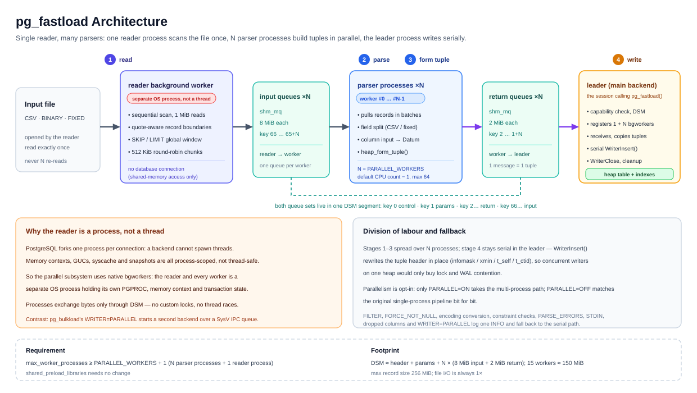

# pg_fastload

**Multi-process parallel bulk loader for PostgreSQL.**
It adds a "single reader, many parsers" pipeline next to the single-process one: reading the
input file and turning records into tuples is spread across several PostgreSQL background
workers, while the insert stage stays in one process and one transaction.

- Version: `1.0.0`
- Author: **yuanyuansong**
- License: **BSD 3-Clause** (see [LICENSE](LICENSE) / [COPYRIGHT](COPYRIGHT) / [NOTICE](NOTICE))
- Provenance: a **derivative implementation built on [pg_bulkload](https://github.com/ossc-db/pg_bulkload) 3.1.23**
  (source-level fork plus a new parallel subsystem) — not a wrapper, not a repackaged branch.
  See [§2](#2-how-it-differs-from-pg_bulkload).

---

## 1. The problem

`pg_bulkload` splits a load into four stages, all executed **serially inside one backend**:

| # | Stage | Work |
|---|---|---|
| ① | Read input | `SourceRead()` pulls bytes from a file/STDIN |
| ② | Parse records | record-boundary state machine + field splitting (CSV unquoting/escaping; fixed-length by `STRIDE`) |
| ③ | Form tuples | column input functions → `Datum` → `heap_form_tuple()` |
| ④ | Insert | `WriterInsert()` (`DIRECT` / `BUFFERED`) |

On a modern multi-core box, ①②③ are pure CPU work (byte-at-a-time state machine, one input
function per column) and saturate a single core while the rest idle; ④ cannot simply be
parallelised (see [ARCHITECTURE.en.md §5](docs/ARCHITECTURE.en.md)).

`pg_fastload` **hands ①②③ to N worker processes and keeps ④ serial in the backend that
issued the load**. One load goes from "one process doing four things" to "one reader + N
parsers + one writing leader".

1 GiB / 7.37 M rows CSV (16 vCPU, warm cache, `DIRECT`, no indexes):

| Configuration | Time | vs serial |
|---|---|---|
| `PARALLEL=OFF` (upstream serial path) | 7.99 s | 1.00× |
| `PARALLEL=ON, PARALLEL_WORKERS=2` | 3.52 s | 2.27× |
| `PARALLEL=ON, PARALLEL_WORKERS=4` | 1.92 s | 4.16× |
| `PARALLEL=ON` (15 workers, default) | **1.76 s** | **4.54×** |

Other sizes, the fixed-length format and cold-cache results: [docs/BENCHMARK.md](docs/BENCHMARK.md).

---

## 2. How it differs from pg_bulkload

> Short version: `pg_fastload` reuses the pg_bulkload **single-process loading pipeline**
> (reader / parser / checker / writer / source modules and every control-file keyword) and adds
> a **parallel subsystem built on native PostgreSQL shared memory**. The parallel path reuses
> none of pg_bulkload's process model, IPC or transaction strategy — the two designs even pull
> in opposite directions (see "Direction of parallelism" below).

### 2.1 Design philosophy

| Aspect | pg_bulkload 3.1.23 | pg_fastload 1.0.0 |
|---|---|---|
| Process model | one backend runs ①②③④ serially | one reader + N parser workers + one writing leader |
| Direction of parallelism | `WRITER=PARALLEL` moves **stage ④** into a second backend (via libpq) | `PARALLEL=ON` distributes **stages ①②③** over N background workers |
| Inter-process communication | SysV IPC queue (`pgut/pgut-ipc.c`), needs an extra DB connection | native `dsm` / `shm_toc` / `shm_mq`, no extra connection |
| File reads | one per process on the serial path | always **one**: a single reader scans once and distributes |
| Transaction semantics | the parallel writer commits separately, so rows become visible before the caller commits | every insert happens inside the caller's transaction, same atomicity as the serial path |
| How parallelism is exposed | — | **no new `TYPE`**: `PARALLEL=ON` makes `TYPE=CSV / BINARY / FIXED` go parallel |
| Serial path | original implementation | **bit-for-bit unchanged** (`PARALLEL=OFF` behaves like pg_bulkload) |

### 2.2 Features

| Capability | pg_bulkload 3.1.23 | pg_fastload 1.0.0 |
|---|---|---|
| Parallel CSV loading | ✗ | ✓ |
| Parallel fixed-length (`BINARY` / `FIXED`) loading | ✗ | ✓ |
| Parallel `TUPLE` / `FUNCTION` | — | ✗ (falls back to serial) |
| Automatic downgrade with an `INFO` line | — | ✓ (13 cases, see [§5](#5-automatic-downgrade)) |
| Stage-level profiling | partial | ✓ GLOBAL / PARALLEL / WORKER, including per-worker SCAN/FORM/IPC |
| Skip spool work on unindexed tables | ✗ | ✓ (`SpoolerInsert()` early return, ~0.28 s/1 GiB) |
| Per-row error tolerance + badfile | ✓ | ✓ (serial path; the parallel path fails the load instead) |
| Every original control keyword | ✓ | ✓ (unchanged semantics, incl. `WRITER=PARALLEL`) |

### 2.3 Usage

| Item | pg_bulkload 3.1.23 | pg_fastload 1.0.0 |
|---|---|---|
| Extension / schema | `pg_bulkload` / `pgbulkload` | `pg_fastload` / `pgfastload` |
| SQL entry point | `pgbulkload.pg_bulkload(ARRAY[...])` | `pgfastload.pg_fastload(ARRAY[...])` |
| Command line | `pg_bulkload control.ctl` | `pg_fastload control.ctl` |
| Enabling parallelism | only `WRITER=PARALLEL` (parallelises the writer) | new `PARALLEL = ON` + `PARALLEL_WORKERS = n` |
| `WRITER=PARALLEL` | the supported parallel mode | **original semantics kept**, and never stacked with `PARALLEL=ON` (the reader then stays serial and logs an INFO) |
| Default degree of parallelism | n/a | online CPUs − 1 (capped at 64) |
| Migration cost | — | rename `pg_bulkload`→`pg_fastload`, `pgbulkload`→`pgfastload`; control files are reusable as-is |

Parallelism is not a new `TYPE`: no extra type name is introduced — `PARALLEL` is an execution mode
and `TYPE` stays at the five upstream values `CSV / BINARY / FIXED / TUPLE / FUNCTION`. Full keyword
semantics: [docs/USER_MANUAL.en.md](docs/USER_MANUAL.en.md).

---

## 3. Architecture



(The Chinese diagram is `docs/img/architecture.zh-CN.svg`; both are vector graphics.)

> **The reader is a process, not a thread.** It is registered through
> `RegisterDynamicBackgroundWorker()`, so it is a PostgreSQL background worker: its own PID, its own
> `PGPROC`, memory context and transaction state, a peer of any `postgres` backend. PostgreSQL
> backends are forked, not threaded (memory contexts, GUCs, syscache and snapshots are not
> thread-safe), so parallelism has to be process-based; processes exchange bytes only through DSM,
> which removes the need for hand-rolled locks. See
> [ARCHITECTURE.en.md §12](docs/ARCHITECTURE.en.md#12-why-the-reader-and-the-workers-are-processes-never-threads).

| Component | Runs as | Responsibility | Code |
|---|---|---|---|
| **leader** | the backend that calls `pgfastload.pg_fastload()` | parse options, create the DSM segment, register workers, run stage ④ `WriterInsert()` **serially**, aggregate statistics, clean up | `lib/pg_fastload.c`, `lib/fastload_parallel.c` |
| **reader** | dynamic bgworker (no DB connection, `BGWORKER_SHMEM_ACCESS` only) | single sequential pass over the input: quote-aware record-boundary state machine for CSV, `STRIDE` splitting for fixed-length; `SKIP`/`LIMIT` window trimming; dispatch to each worker's input queue in ~512 KiB chunks | `lib/fastload_worker.c` (`pg_fastload_reader_main`) |
| **worker × N** | dynamic bgworker (full backend: own memory contexts, transaction, syscache) | dequeue records → split fields → column input functions → `heap_form_tuple()` → send the finished tuple back | `lib/fastload_worker.c` (`pg_fastload_worker_main`) |
| **DSM segment** | anonymous shared memory (`dsm_create` + `dsm_pin_segment`) | key 0 `FastloadShared` (states/errors/row counts), key 1 `FastloadParams` (options, column defs, fixed-length descriptors), keys 2.. return `shm_mq` × N (2 MiB), keys 66.. input `shm_mq` × N (8 MiB) | `include/fastload_parallel.h` |
| **single-process pipeline** | inside the leader (`PARALLEL=OFF` or downgraded) | the upstream reader/parser/checker/writer: `ReaderNext()` × N → `WriterInsert()` | `lib/reader.c`, `lib/parser_*.c`, `lib/writer_*.c` |

Key points (details in [docs/ARCHITECTURE.en.md](docs/ARCHITECTURE.en.md)):

1. **File I/O happens exactly once.** CSV is not randomly addressable (the quote state at an
   arbitrary byte offset is unknown), so the reader does one sequential pass over the whole file
   instead of starting N workers at byte offsets; total reads stay at 1× the file size, so the
   speedup does not invert once the file exceeds the page cache.
2. **Only finished tuples cross process boundaries.** Workers rebuild a `TupleDesc` from column
   definitions serialised by the leader and **never open the target table**, avoiding any lock
   conflict with the leader's `AccessExclusiveLock`.
3. **Stage ④ stays serial.** `WriterInsert()` modifies `tuple->t_data` in place (infomask, xmin,
   `t_self`, `t_ctid`); concurrent writers on one heap only add lock and WAL contention. Because
   queue memory is read-only shared memory, the leader must `palloc` a writable copy in
   `wt->context` before handing it to `WriterInsert()`.
4. **All IPC uses core PostgreSQL primitives** (`dsm`/`shm_toc`/`shm_mq`) — no hand-rolled locks,
   no third-party queues. EOF is signalled by the reader setting `DONE` and then detaching; a
   worker seeing `DETACHED` checks that state to distinguish a clean end from a crash.
5. **Downgrade before failing.** Whenever the parallel path cannot guarantee identical semantics,
   it falls back to the upstream single-process path and logs one INFO line.

**Resource requirement**: `max_worker_processes ≥ PARALLEL_WORKERS + 1` (N parsers + 1 reader).
With the default 15 workers the DSM input queues account for ~144 MiB
(8 MiB × 15 + 2 MiB × 15 + control blocks).

---

## 4. Quick start

### 4.1 Build and install

You need PostgreSQL server headers (or a source tree) and the matching `pg_config`:

```bash
make USE_PGXS=1 PG_CONFIG=/path/to/pg_config
sudo make USE_PGXS=1 PG_CONFIG=/path/to/pg_config install
```

```sql
CREATE EXTENSION pg_fastload;
```

`shared_preload_libraries` is **not** required; just make sure `max_worker_processes` is large
enough (≥ 32 is a good default when using the default 15 workers). Restart after changing a GUC.

### 4.2 First, decide which machine holds the control file

This is the single most common trap when migrating from pg_bulkload, so here is the answer first:

| Usage | Control file lives on | Data file (`INPUT`) lives on | Why |
|---|---|---|---|
| **SQL interface**<br>`SELECT pgfastload.pg_fastload(ARRAY[...])` | **there is no control file** | **the database server** | keywords are passed inline as an array; `INPUT` is `open()`ed by the server backend / reader process |
| **Command line**<br>`pg_fastload xxx.ctl` | **the client machine**<br>(where you type the command) | **the database server** | the CLI is a thin client: it reads the control file locally, then calls `pg_fastload()` on the server over libpq |

Three hard consequences:

1. **With the SQL interface there is no control file at all.** Keywords go straight into
   `ARRAY['KEY=VALUE', ...]`. Dropping a `.ctl` file on the client does nothing — the server never
   sees it and never reads it.
2. **`INPUT` is always a server-side path.** In both usages the file is opened by the database
   server's OS user (usually `postgres`), so the path must exist on that machine and be readable by
   that user. A client-local path such as `C:\data\a.csv` or `/home/me/a.csv` fails with
   `could not open file`.
3. **Relative paths in a control file are expanded on the client before they are sent.** The CLI
   resolves `INPUT` against the control file's directory and sends an absolute path, so when the
   control file is on the client and the data file is on the server, **write the server's absolute
   path** rather than a relative one.

> Rule of thumb: **the control file follows the client, the data file follows the server, and the
> SQL interface has no control file at all.**

### 4.3 Option 1: the `pg_fastload` command-line tool

Put the control file on the **client** (for example `./order_line.ctl`):

```
OUTPUT            = public.order_line
INPUT             = /tmp/tpcc/order_line.csv     # absolute path on the server
TYPE              = CSV
WRITER            = DIRECT
DELIMITER         = ','
PARALLEL          = ON
PARALLEL_WORKERS  = 8
```

Run it with connection parameters:

```bash
pg_fastload -d tpcc -h 192.168.25.134 -p 5432 -U ysyuan order_line.ctl
```

Connection and general options (provided by the pgut front end):

| Option | Meaning |
|---|---|
| `-d, --dbname` | database name; defaults to `PGDATABASE`, then to the connection user |
| `-h, --host` / `-p, --port` | server address and port |
| `-U, --username` | connection user |
| `-w, --no-password` | never prompt (use `.pgpass` / `PGPASSWORD`) |
| `-W, --password` | force a password prompt |
| `-e, --echo` | echo the SQL that is executed |
| `-E, --elevel` | adjust the log level |

Load options:

| Option | Meaning |
|---|---|
| `-o "KEY=VALUE"` | append or override a single keyword; repeatable, wins over the control file |
| `-i, --input` / `-O, --output` | specify input / output directly, no control file needed |
| `-l, --logfile` | log file path |
| `-P, --parse-badfile` | bad-record file path |
| `-u, --duplicate-badfile` | duplicate-record file path |
| `-r, --recovery` + `-D, --pgdata` | recovery mode: clean up state left by an interrupted `DIRECT` load |

No need to edit the control file just to change one or two settings:

```bash
pg_fastload order_line.ctl -o "PARALLEL_WORKERS=4"
```

If a `WRITER=DIRECT` load was interrupted the table may be unusable; clean it up with:

```bash
pg_fastload -r -D /var/lib/pgsql/data
```

### 4.4 Option 2: the SQL interface

Call it from **any** session where the extension is installed (local `psql`, an application pool,
a BI client — anything):

```sql
SELECT * FROM pgfastload.pg_fastload(ARRAY[
  'INPUT=/tmp/tpcc/order_line.csv',   -- absolute path on the server
  'OUTPUT=public.order_line',
  'TYPE=CSV',
  'WRITER=DIRECT',
  'PARALLEL=ON',
  'PARALLEL_WORKERS=8'
]);
```

The function returns one row of statistics:

| Column | Meaning |
|---|---|
| `skip` | rows skipped by `SKIP` |
| `count` | rows actually loaded |
| `parse_errors` | rows that failed to parse (the parallel path fails the whole load instead, see §6) |
| `duplicate_new` / `duplicate_old` | new / old row counts under a `DUPLICATE_*` policy |
| `system_time` / `user_time` / `duration` | server-side CPU and wall-clock seconds |

Just the count and the duration:

```sql
SELECT count, duration FROM pgfastload.pg_fastload(ARRAY[...]);
```

Both options are equivalent: the CLI literally issues
`BEGIN; SELECT pgfastload.pg_fastload(ARRAY[...]); COMMIT;`.
The only difference is who reads the control file and how paths are written.

Full keyword list and return columns: [docs/USER_MANUAL.en.md](docs/USER_MANUAL.en.md).

---

## 5. Automatic downgrade

With `PARALLEL=ON`, the following cases silently fall back to the upstream single-process path
(one `INFO` line is logged). Results are identical to serial, only without the speedup:

| # | Trigger | Why |
|---|---|---|
| 1 | `PARALLEL` off, or effective workers ≤ 1 | a single worker is pure overhead |
| 2 | `TYPE` is `TUPLE` / `FUNCTION` | not parallelised yet |
| 3 | `FILTER` or `FORCE_NOT_NULL` given | needs the original per-field rewrite/override |
| 4 | target table has dropped columns | column mapping vs DSM parameter block |
| 5 | explicit `ENCODING` requiring per-field conversion | workers do not call `CheckerConversion()` |
| 6 | table has `NOT NULL` columns, or `CHECK_CONSTRAINTS` given | workers do not run `CheckerConstraints()` |
| 7 | `PARSE_ERRORS != 0` (incl. `PARSE_BADFILE`) | per-row tolerance lives only on the serial path |
| 8 | `INPUT = STDIN` or missing | the reader needs a path it can `open()` |
| 9 | `WRITER=PARALLEL` / `MULTI_PROCESS=YES` | never stacked with the parallel reader (still writes in a separate process/transaction) |
| 10 | fixed-length: no `COL` descriptor or `STRIDE ≤ 0` | record boundaries undefined |
| 11 | fixed-length: a `NULLIF` pattern longer than 64 bytes | does not fit the DSM slot |
| 12 | fixed-length: trailing bytes shorter than `STRIDE` at EOF | same as serial: ignored with a WARNING |
| 13 | target `TupleDesc` unavailable | nothing to send to workers |

Downgrading is a **safety net, not an error**: `PARALLEL=ON` is always safe to enable.

---

## 6. Constraints you should know

1. **No per-row tolerance on the parallel path.** A bad row (wrong field count, input-function
   error, unterminated quote) aborts the worker and the whole load; it is **not** written to
   `PARSE_BADFILE`. Use `PARALLEL=OFF` when you need tolerance.
2. **Row order is not guaranteed.** Chunk round-robin routing plus multi-process inserts; the
   correctness contract is the row multiset (`count(*) || sum(hash_record_extended(t,0))`).
3. **Encoding assumption.** The parallel path assumes input encoding = database encoding. For
   non-ASCII data with a different encoding, set `ENCODING` explicitly or use `PARALLEL=OFF`.
4. **Do not combine `MULTI_PROCESS=YES` with `TRUNCATE` in one session** — inherited pg_bulkload
   behaviour: the parallel writer's second backend cannot acquire the lock held by the session's
   own `TRUNCATE`, so it waits until timeout. Truncate from a **separate session** (or use
   `TRUNCATE=YES`).
5. **Record size limit**: 256 MiB per record (reader buffer cap).

---

## 7. Documentation

| Document | Chinese | English |
|---|---|---|
| User manual (install / all keywords / usage / FAQ) | [docs/USER_MANUAL.md](docs/USER_MANUAL.md) | [docs/USER_MANUAL.en.md](docs/USER_MANUAL.en.md) |
| Architecture (components, data flow, IPC, downgrade design) | [docs/ARCHITECTURE.md](docs/ARCHITECTURE.md) | [docs/ARCHITECTURE.en.md](docs/ARCHITECTURE.en.md) |
| Portability (PG 15–19 differences and verification) | [docs/PORTING.md](docs/PORTING.md) | [docs/PORTING.en.md](docs/PORTING.en.md) |
| Changes relative to pg_bulkload | [docs/CHANGES.md](docs/CHANGES.md) | — |
| Benchmarks | [docs/BENCHMARK.md](docs/BENCHMARK.md) | — |
| Verification report | [docs/VERIFICATION.md](docs/VERIFICATION.md) | — |
| Optimization log and rejected ideas | [docs/OPTIMIZATION.md](docs/OPTIMIZATION.md) | — |

---

## 8. Compatibility and license

- **Verified on**: PostgreSQL 15.19 / 16.15 / 17.11 / 18.6 / 19rc1, x86_64 Linux, 16 vCPU. All five
  majors were run through the same functional suite (`util/fl_ver_test.sh`): serial vs parallel CSV,
  serial vs parallel fixed length, the `FILTER` downgrade, parse-error handling and the CLI client.
  Every difference and its fix is listed in [docs/PORTING.en.md](docs/PORTING.en.md); each major has
  a matching `REL_1x_STABLE` branch.
- **Attribution**: `COPYRIGHT` is preserved byte for byte and every inherited source file keeps its
  `Copyright (c) ... NTT, Inc.` header. The parallel subsystem is
  Copyright (c) 2026, yuanyuansong, released under the same BSD 3-Clause terms.
- **No endorsement**: neither NTT, Inc. nor the pg_bulkload contributors endorse or sponsor this
  derivative work, and no upstream trademark is used for promotion.
- Binary redistribution must ship `LICENSE` / `COPYRIGHT` and the disclaimer
  (BSD 3-Clause clauses 1 and 2).
