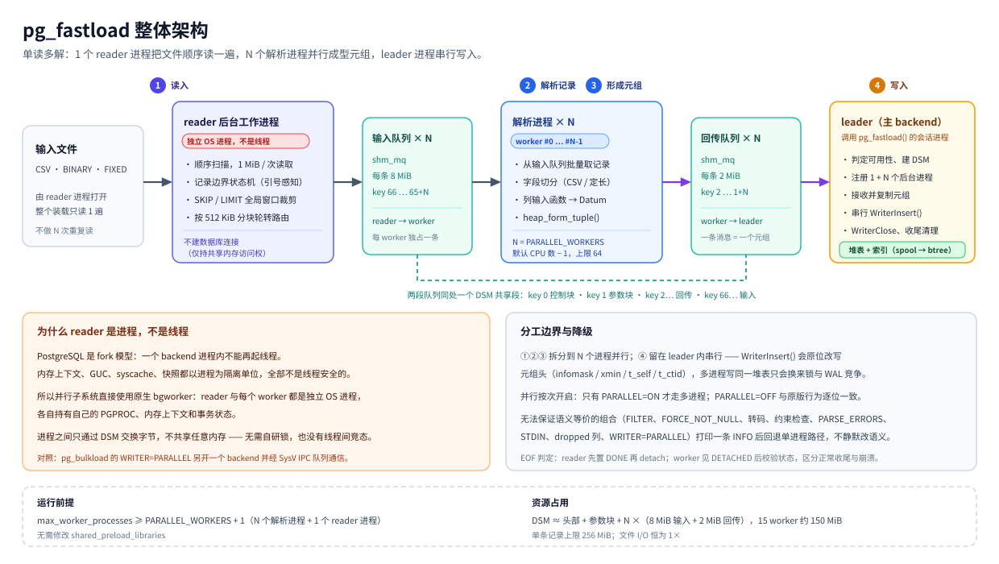

# pg_fastload

**PostgreSQL 多进程并行批量加载扩展**　—— 在单进程管道之外增加「单读多解」并行通路，
把读文件与解析/成型元组的工作分摊到多个 PostgreSQL 后台进程，写入保持单事务、单进程。

- 版本：`1.0.0`
- 作者：**yuanyuansong**
- 许可：**BSD 3-Clause**（见 [LICENSE](LICENSE) / [COPYRIGHT](COPYRIGHT) / [NOTICE](NOTICE)）
- 来源：本项目**基于 [pg_bulkload](https://github.com/ossc-db/pg_bulkload) 3.1.23 二次实现**（源码级 fork + 新增并行子系统），
  并非对 pg_bulkload 的直接使用、封装或分支发布。区别详见 [§2](#2-与-pg_bulkload-的区别)。

---

## 1. 它解决什么问题

`pg_bulkload` 把一次加载拆成四个阶段，全部在**同一个 backend 进程里串行**执行：

| # | 阶段 | 主要工作 |
|---|---|---|
| ① | 读输入 | `SourceRead()` 从文件/STDIN 取字节流 |
| ② | 解析记录 | 记录边界状态机 + 字段切分（CSV 去引号/转义；定长按 STRIDE 切分） |
| ③ | 形成元组 | 列输入函数 → `Datum` → `heap_form_tuple()` |
| ④ | 写入数据库 | `WriterInsert()`（DIRECT / BUFFERED） |

在现代多核机器上，①②③ 是纯 CPU 工作（逐字节状态机 + 逐字段输入函数），
单核跑满而其他核空闲；④ 无法轻易并行（见 [ARCHITECTURE.md §9](docs/ARCHITECTURE.md#9-为什么-④-保持串行)）。

`pg_fastload` 的做法是：**把 ①②③ 拆给 N 个后台进程并行做，④ 仍由发起加载的 backend 串行做**。
一次加载的进程结构从「1 个进程干 4 件事」变成「1 个 reader 读 + N 个 worker 解析 + 1 个 leader 写」。

1 GiB / 737 万行 CSV 实测（16 vCPU，热缓存，DIRECT，无索引）：

| 配置 | 耗时 | 相对串行 |
|---|---|---|
| `PARALLEL=OFF`（原版串行路径） | 7.99 s | 1.00× |
| `PARALLEL=ON, PARALLEL_WORKERS=2` | 3.52 s | 2.27× |
| `PARALLEL=ON, PARALLEL_WORKERS=4` | 1.92 s | 4.16× |
| `PARALLEL=ON`（默认 15 worker） | **1.76 s** | **4.54×** |

全量数据与更大/更小规模、定长格式、冷缓存的结果见 [docs/BENCHMARK.md](docs/BENCHMARK.md)。

---

## 2. 与 pg_bulkload 的区别

> 结论先行：`pg_fastload` 复用 pg_bulkload 的**单进程加载管道**（reader / parser / checker /
> writer / source 模块与全部控制文件关键字），在其之上**新增了一套基于 PostgreSQL 原生
> 共享内存的并行子系统**；并行路径不复用 pg_bulkload 的任何进程模型、IPC 机制或事务策略。
> 两者不是同一个东西的两种写法，取舍方向甚至相反（见下表「并行方向」）。

### 2.1 设计思路

| 维度 | pg_bulkload 3.1.23 | pg_fastload 1.0.0 |
|---|---|---|
| 进程模型 | 单 backend 串行完成 ①②③④ | 单 reader + N 解析 worker + leader 写入 |
| 并行化的方向 | `WRITER=PARALLEL` 把 **④ 写入**搬到第二个 backend（经 libpq 连接） | `PARALLEL=ON` 把 **①②③ 读/解析** 分摊到 N 个 bgworker |
| 进程间通信 | SysV IPC 队列（`pgut/pgut-ipc.c`），需要额外数据库连接 | PostgreSQL 原生 `dsm` / `shm_toc` / `shm_mq`，不需要额外连接 |
| 文件读取次数 | 每进程各读一遍（串行路径 1 次） | 恒为 **1 次**：单个 reader 单遍扫描后分发 |
| 事务语义 | 并行 writer 用独立事务，调用方提交前数据已对外可见 | 全部插入都在调用方事务内，与串行路径原子性一致 |
| 类型暴露方式 | — | **不新增 TYPE**：`PARALLEL=ON` 时 `TYPE=CSV / BINARY / FIXED` 自动走并行 |
| 串行路径 | 原始实现 | **逐位保持不变**（`PARALLEL=OFF` 与 pg_bulkload 行为一致） |

### 2.2 功能特性

| 能力 | pg_bulkload 3.1.23 | pg_fastload 1.0.0 |
|---|---|---|
| CSV 多进程并行加载 | ✗ | ✓ |
| 定长（`BINARY` / `FIXED`）并行加载 | ✗ | ✓ |
| `TUPLE` / `FUNCTION` 并行 | — | ✗（自动降级串行） |
| 不支持的语义自动降级 + INFO 提示 | — | ✓（13 类，见 [§5](#5-自动降级清单)） |
| 阶段级耗时剖析（profile） | 部分阶段 | ✓ GLOBAL / PARALLEL / WORKER 全阶段，含 worker 侧 SCAN/FORM/IPC |
| 无索引表的 spool 空转消除 | ✗ | ✓（`SpoolerInsert()` 早退，省 ~0.28 s/1 GiB） |
| 逐行容错 + badfile | ✓ | ✓（串行路径；并行路径按失败处理，见限制） |
| 装载进度显示 | ✗ | ✓（`PROGRESS=ON`：百分比、行数、MiB/s、ETA，见 [§4.5](#45-观察长装载的进度)） |
| 全部原有控制文件关键字 | ✓ | ✓（语义不变，含 `WRITER=PARALLEL`） |

### 2.3 使用方式

| 项 | pg_bulkload 3.1.23 | pg_fastload 1.0.0 |
|---|---|---|
| 扩展 / schema | `pg_bulkload` / `pgbulkload` | `pg_fastload` / `pgfastload` |
| SQL 入口 | `pgbulkload.pg_bulkload(ARRAY[...])` | `pgfastload.pg_fastload(ARRAY[...])` |
| 命令行 | `pg_bulkload control.ctl` | `pg_fastload control.ctl` |
| 开启并行 | 只能用 `WRITER=PARALLEL`（并行的是写入端） | 新增 `PARALLEL = ON` + `PARALLEL_WORKERS = n` |
| `WRITER=PARALLEL` | 支持的并行方式 | **保留原语义**，且不与 `PARALLEL=ON` 叠加（自动回到串行 reader 并提示） |
| 默认并行度 | 不适用 | 未指定时 = 在线 CPU 核数 − 1（上限 64） |
| 迁移成本 | — | 把 `pg_bulkload` 换成 `pg_fastload`、`pgbulkload` 换成 `pgfastload` 即可；控制文件可原样复用 |

并行不是一种新的 `TYPE`：本项目没有引入任何额外的类型名，`PARALLEL` 只是执行模式，
`TYPE` 仍然是 `CSV / BINARY / FIXED / TUPLE / FUNCTION` 五种。完整关键字语义见
[docs/USER_MANUAL.md](docs/USER_MANUAL.md)。

---

## 3. 架构



（英文版图：`docs/img/architecture.svg`；矢量图，可直接缩放查看。）

> **reader 是进程，不是线程。** 它由 `RegisterDynamicBackgroundWorker()` 注册，是 PostgreSQL 的
> 后台工作进程（bgworker），拥有独立的 PID、`PGPROC`、内存上下文与事务状态，与外部的
> `postgres` backend 平级。PostgreSQL 的 backend 是 fork 模型，进程内不允许创建线程
> （内存上下文、GUC、syscache、快照都不是线程安全的），因此并行只能用进程实现；
> 进程之间只通过 DSM 交换字节，不需要自研锁。详见
> [ARCHITECTURE.md §12](docs/ARCHITECTURE.md#12-为什么-reader-与-worker-都是独立进程而不是线程)。

| 组件 | 进程形态 | 职责 | 代码 |
|---|---|---|---|
| **leader** | 发起 `pgfastload.pg_fastload()` 的 backend | 解析参数、创建 DSM、注册 bgworker、**串行**执行 ④ `WriterInsert()`、汇总统计与收尾清理 | `lib/pg_fastload.c`、`lib/fastload_parallel.c` |
| **reader** | 动态 bgworker（无数据库连接，仅 `BGWORKER_SHMEM_ACCESS`） | 单遍扫描输入文件：CSV 走 quote-aware 记录边界状态机，定长按 STRIDE 切分；按 `SKIP/LIMIT` 全局窗口裁剪；按 ~512 KiB 分块轮转把记录分发到各 worker 的输入队列 | `lib/fastload_worker.c`（`pg_fastload_reader_main`） |
| **worker × N** | 动态 bgworker（完整 backend，各自有内存上下文/事务/syscache） | 从输入队列取记录 → 字段切分 → 列输入函数 → `heap_form_tuple()` → 成型元组经回传队列发回 leader | `lib/fastload_worker.c`（`pg_fastload_worker_main`） |
| **DSM 共享段** | 匿名共享内存（`dsm_create` + `dsm_pin_segment`） | key 0 `FastloadShared`（状态/错误/行数）、key 1 `FastloadParams`（参数/列定义/定长描述符）、key 2.. 回传 `shm_mq` × N（2 MiB）、key 66.. 输入 `shm_mq` × N（8 MiB） | `include/fastload_parallel.h` |
| **单进程管道** | 同 leader 进程内（`PARALLEL=OFF` 或降级时） | 原版 reader/parser/checker/writer：`ReaderNext()` × N → `WriterInsert()` | `lib/reader.c`、`lib/parser_*.c`、`lib/writer_*.c` |

设计要点（详见 [docs/ARCHITECTURE.md](docs/ARCHITECTURE.md)）：

1. **文件 I/O 只发生 1 次**。CSV 不是可随机访问格式（任意字节偏移处的引号状态未知），
   所以 reader 做整文件顺序单遍扫描，而不是按字节区间分段起跑；总读量恒为 1× 文件大小，
   文件超出 page cache 时并行收益不会反转。
2. **只交换成型元组**，不共享事务状态。worker 由 leader 序列化过去的列定义重建 `TupleDesc`，
   **不打开目标表**，避免与 leader 的 `AccessExclusiveLock` 冲突。
3. **④ 保持串行**。`WriterInsert()` 会原地修改 `tuple->t_data`（infomask / xmin / t_self / t_ctid），
   多进程写同一堆表只会引入锁与 WAL 竞争；leader 收到共享内存中的只读消息后，
   必须在自己的 `wt->context` 里 `palloc` 出可写副本再交给 `WriterInsert()`。
4. **全部 IPC 用 PostgreSQL 内核原语**（`dsm`/`shm_toc`/`shm_mq`），没有自研锁、没有第三方队列；
   EOF 语义为「reader 先置 `DONE` 再 detach，worker 见 `DETACHED` 后校验状态区分正常收尾与崩溃」。
5. **先降级、后失败**。任何并行路径无法保证语义等价的情形，一律回退原版单进程路径并打印 INFO。

**资源要求**：`max_worker_processes ≥ PARALLEL_WORKERS + 1`（N 个解析 worker + 1 个 reader）。
默认 15 worker 时 DSM 输入队列约 144 MiB（8 MiB × 15 + 2 MiB × 15 + 控制块）。

---

## 4. 快速开始

### 4.1 构建与安装

需要 PostgreSQL 服务端头文件（`postgresql-server-dev-*` 或源码树）与对应的 `pg_config`：

```bash
make USE_PGXS=1 PG_CONFIG=/path/to/pg_config
sudo make USE_PGXS=1 PG_CONFIG=/path/to/pg_config install
```

```sql
CREATE EXTENSION pg_fastload;
```

`shared_preload_libraries` **不需要**改；只需保证 `max_worker_processes` 足够
（并行默认值 15 时建议 ≥ 32）。改 GUC 后重启实例。

### 4.2 先搞清楚一件事：控制文件放在哪台机器

这是从 pg_bulkload 迁移过来最容易踩的坑，先给结论：

| 用法 | 控制文件在哪 | 数据文件（`INPUT`）在哪 | 原因 |
|---|---|---|---|
| **SQL 接口**<br>`SELECT pgfastload.pg_fastload(ARRAY[...])` | **没有控制文件** | **数据库服务器** | 关键字以数组内联传入；`INPUT` 由服务端 backend / reader 进程 `open()` |
| **命令行**<br>`pg_fastload xxx.ctl` | **客户端机器**<br>（你敲命令的那台） | **数据库服务器** | CLI 只是瘦客户端：本地读控制文件 → 经 libpq 调用服务端的 `pg_fastload()` |

由此得到三条硬结论：

1. **用 SQL 接口时不存在控制文件。** 关键字直接写成 `ARRAY['KEY=VALUE', ...]` 传给函数；
   客户端磁盘上放一个 `.ctl` 文件没有任何作用——服务端既看不到它，也不会去读它。
2. **`INPUT` 永远是服务器侧路径。** 两种用法下文件都由数据库服务器的 OS 用户
   （通常是 `postgres`）打开，因此路径必须在该机器上存在且该用户可读。
   客户端本地路径（例如 `C:\data\a.csv`、`/home/me/a.csv`）在服务器上不存在就会报
   `could not open file`。
3. **控制文件里的相对路径会先按客户端目录展开成绝对路径再发给服务端。**
   CLI 以控制文件所在目录为基准把 `INPUT` 拼成绝对路径，所以控制文件在客户端、
   数据文件在服务器时，请**直接写服务器上的绝对路径**。

> 一句话记法：**控制文件跟着客户端走，数据文件跟着数据库服务器走，SQL 接口没有控制文件。**

### 4.3 方式一：命令行工具 `pg_fastload`

控制文件放在**客户端**（例如 `./order_line.ctl`）：

```
OUTPUT            = public.order_line
INPUT             = /tmp/tpcc/order_line.csv     # 服务器上的绝对路径
TYPE              = CSV
WRITER            = DIRECT
DELIMITER         = ','
PARALLEL          = ON
PARALLEL_WORKERS  = 8
```

带上连接参数执行：

```bash
pg_fastload -d tpcc -h 192.168.25.134 -p 5432 -U ysyuan order_line.ctl
```

连接与通用选项（由 pgut 前端提供）：

| 选项 | 含义 |
|---|---|
| `-d, --dbname` | 数据库名；缺省取 `PGDATABASE`，再缺省取连接用户名 |
| `-h, --host` / `-p, --port` | 服务器地址与端口 |
| `-U, --username` | 连接用户 |
| `-w, --no-password` | 不提示密码（改用 `.pgpass` / `PGPASSWORD`） |
| `-W, --password` | 强制提示输入密码 |
| `-e, --echo` | 回显执行的 SQL |
| `-E, --elevel` | 调整日志级别 |

加载相关选项：

| 选项 | 含义 |
|---|---|
| `-o "KEY=VALUE"` | 追加或覆盖单个关键字，可重复，优先级高于控制文件 |
| `-i, --input` / `-O, --output` | 直接指定输入 / 输出，无需写进控制文件 |
| `-l, --logfile` | 指定日志文件 |
| `-P, --parse-badfile` | 坏行文件路径 |
| `-u, --duplicate-badfile` | 重复行文件路径 |
| `-r, --recovery` + `-D, --pgdata` | 恢复模式：清理上一次 `DIRECT` 装载中断留下的状态 |

只改一两个参数时不必编辑控制文件：

```bash
pg_fastload order_line.ctl -o "PARALLEL_WORKERS=4"
```

`WRITER=DIRECT` 装载异常中断后表可能不可用，用恢复模式清理：

```bash
pg_fastload -r -D /var/lib/pgsql/data
```

### 4.4 方式二：SQL 接口

在**任意**已安装扩展的会话里调用（本机 `psql`、应用连接池、BI 客户端都行）：

```sql
SELECT * FROM pgfastload.pg_fastload(ARRAY[
  'INPUT=/tmp/tpcc/order_line.csv',   -- 服务器上的绝对路径
  'OUTPUT=public.order_line',
  'TYPE=CSV',
  'WRITER=DIRECT',
  'PARALLEL=ON',
  'PARALLEL_WORKERS=8'
]);
```

返回一行统计：

| 列 | 含义 |
|---|---|
| `skip` | 被 `SKIP` 跳过的行数 |
| `count` | 实际装载行数 |
| `parse_errors` | 解析错误行数（并行路径出错即整体失败，见 §6） |
| `duplicate_new` / `duplicate_old` | `DUPLICATE_*` 策略下新行 / 旧行的计数 |
| `system_time` / `user_time` / `duration` | 服务端 CPU 与墙钟耗时（秒） |

只看行数与耗时：

```sql
SELECT count, duration FROM pgfastload.pg_fastload(ARRAY[...]);
```

两种用法完全等价：CLI 内部执行的就是
`BEGIN; SELECT pgfastload.pg_fastload(ARRAY[...]); COMMIT;`，
区别只在于控制文件由谁读、路径怎么写。

### 4.5 观察长装载的进度

加两个关键字，语句就会边跑边汇报：

```sql
SELECT * FROM pgfastload.pg_fastload(ARRAY[
  'INPUT=/tmp/tpcc/order_line.csv',
  'OUTPUT=public.order_line',
  'PARALLEL=ON',
  'PROGRESS=ON',
  'PROGRESS_INTERVAL=1000'        -- 两行之间的毫秒数，默认 1000
]);
```

```
NOTICE:  pg_fastload progress: 32.7% | rows 2,410,881 | 334.8 MiB / 1.00 GiB | 129.6 MiB/s | 933.0k rows/s | elapsed 00:00:02 | ETA 00:00:05
NOTICE:  pg_fastload progress: 100.0% | rows 7,375,042 | 1.00 GiB / 1.00 GiB | 137.1 MiB/s | 987.4k rows/s | elapsed 00:00:07 | done
```

进度以 `NOTICE` 形式输出（边跑边到客户端），同时写入 `LOGFILE`；开销是每行一次整数比较。
百分比在何种情况下退化为按 `LIMIT` 行数计算、输入大小未知时怎么显示，见
[USER_MANUAL §12.4](docs/USER_MANUAL.zh-CN.md#124-加载进度)。

完整关键字与返回列见 [docs/USER_MANUAL.md](docs/USER_MANUAL.md)。

---

## 5. 自动降级清单

以下情形 `PARALLEL=ON` **不会**生效，加载自动回到原版单进程路径（日志打印一条 `INFO`），
结果与串行完全一致，只是没有加速：

| # | 触发条件 | 原因 |
|---|---|---|
| 1 | `PARALLEL` 未开启，或有效 worker 数 ≤ 1 | 单 worker 时并行机制纯属开销 |
| 2 | `TYPE` 为 `TUPLE` / `FUNCTION` | 尚未并行化 |
| 3 | 指定 `FILTER` 或 `FORCE_NOT_NULL` | 需要原版逐字段改写/覆盖语义 |
| 4 | 目标表含 dropped 列 | 列映射与 DSM 参数块不一致 |
| 5 | 显式 `ENCODING` 且需逐字段转码 | worker 不调用 `CheckerConversion()` |
| 6 | 表含 `NOT NULL` 列，或指定 `CHECK_CONSTRAINTS` | worker 不执行 `CheckerConstraints()` |
| 7 | `PARSE_ERRORS != 0`（含 `PARSE_BADFILE`） | 逐行容错与写入失败语义只在串行路径实现 |
| 8 | `INPUT = STDIN` 或缺失 | reader 需要可独立 `open()` 的路径 |
| 9 | `WRITER=PARALLEL` / `MULTI_PROCESS=YES` | 不与并行 reader 叠加（仍在调用方事务外另起写入进程） |
| 10 | 定长：无 `COL` 描述、`STRIDE ≤ 0` | 解析器无法确定记录边界 |
| 11 | 定长：任一 `NULLIF` 模式长于 64 字节 | DSM 定长槽位装不下 |
| 12 | 定长：记录不是完整 `STRIDE`（含 EOF 尾残字节） | 与串行一致：尾残忽略并 WARNING |
| 13 | 无法获取目标表 `TupleDesc` | 无列定义可下发 |

降级是**静默失败的安全网**，不是错误：`PARALLEL=ON` 永远可以安全地打开。

---

## 6. 关键使用约束

1. **并行路径无逐行容错**：坏行（字段数不符、输入函数报错、未闭合引号）会让整条流水线停下：
   先输出与串行相同的 `Parse error Record N ...` WARNING，把该记录追加到 `PARSE_BADFILE`，
   然后语句失败、整次装载回滚（全有或全无 —— 并行装载绝不会保留一个依赖时序的部分集合）。
   需要 pg_bulkload 那种「保留错误前已读行」的语义请用 `PARALLEL=OFF`。
2. **不保证物理行序**：分块轮转路由 + 多进程插入，正确性以内容集合为准
   （验证用 `count(*) || sum(hash_record_extended(t,0))`）。
3. **编码假设**：并行路径假设输入编码 = 数据库编码；非 ASCII 且编码不同时请显式 `ENCODING`
   或 `PARALLEL=OFF`。
4. **`MULTI_PROCESS=YES` 与 `TRUNCATE` 不要写在同一个会话里**——这是 pg_bulkload 继承下来的
   行为：并行 writer 的第二个 backend 拿不到本会话 `TRUNCATE` 持有的锁，会自锁直到超时。
   加载前请在**另一个会话**里 `TRUNCATE`（或 `TRUNCATE=YES`）。
5. **单条记录上限 256 MiB**（reader 的记录缓冲上限）。

---

## 7. 文档

| 文档 | 中文 | English |
|---|---|---|
| 用户手册（安装 / 关键字全表 / 用法 / FAQ） | [docs/USER_MANUAL.md](docs/USER_MANUAL.md)（英） | [docs/USER_MANUAL.zh-CN.md](docs/USER_MANUAL.zh-CN.md)（中） |
| 架构（组件职责、数据流、IPC 协议、降级设计） | [docs/ARCHITECTURE.md](docs/ARCHITECTURE.md)（英） | [docs/ARCHITECTURE.zh-CN.md](docs/ARCHITECTURE.zh-CN.md)（中） |
| 多版本适配（PG 15–19 差异与验收结果） | [docs/PORTING.md](docs/PORTING.md)（英） | [docs/PORTING.zh-CN.md](docs/PORTING.zh-CN.md)（中） |
| 相对 pg_bulkload 的修改点 | [docs/CHANGES.md](docs/CHANGES.md) | — |
| 性能基准 | [docs/BENCHMARK.md](docs/BENCHMARK.md) | — |
| 验证报告（用例、正确性、内存、合规） | [docs/VERIFICATION.md](docs/VERIFICATION.md) | — |
| 优化记录与未采纳方案 | [docs/OPTIMIZATION.md](docs/OPTIMIZATION.md) | — |

---

## 8. 兼容性与许可

- **验证环境**：PostgreSQL 15.19 / 16.15 / 17.11 / 18.6 / 19rc1，x86_64 Linux，16 vCPU。
  五个主版本都用 `util/fl_ver_test.sh` 跑过同一套功能验收（CSV 串行/并行、定长串行/并行、
  `FILTER` 降级、解析错误处理、命令行客户端），全部通过；版本差异与逐条适配说明见
  [docs/PORTING.md](docs/PORTING.md)。每一代主版本有对应的 `REL_1x_STABLE` 分支。
- **上游署名**：`COPYRIGHT` 原文逐字节保留，每个继承源文件头部保留 `Copyright (c) ... NTT, Inc.`；
  并行子系统的版权归 yuanyuansong (2026)，以相同 BSD 3-Clause 条款发布。
- **非背书**：本项目未获 NTT, Inc. 或 pg_bulkload 贡献者背书或赞助；不使用其商标做推广。
- 二进制分发时须随附 `LICENSE` / `COPYRIGHT` 与免责条款（BSD 3-Clause 第 1、2 条要求）。
