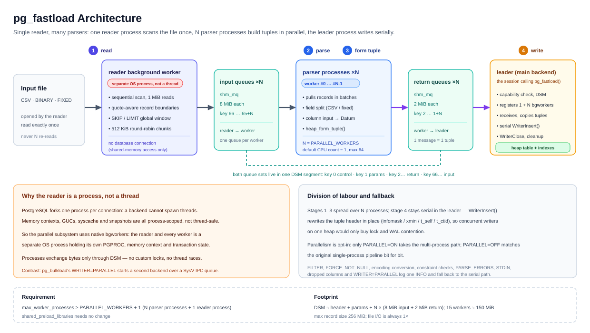

# pg_fastload Architecture

> Version `1.0.0`. This document describes the **current implementation** (the single-reader,
> multi-parser architecture) and maps one-to-one onto the code.
> Based on pg_bulkload 3.1.23 (Copyright NTT, Inc.); parallel subsystem Copyright (c) 2026 yuanyuansong.
> Chinese version: [ARCHITECTURE.zh-CN.md](ARCHITECTURE.zh-CN.md)

---

## 1. The four-stage pipeline

A load is split into four stages, and that split is the backbone of the whole parallelisation:

| # | Stage | Work | Code |
|---|---|---|---|
| ① | Read input | `SourceRead()` pulls bytes from INPUT | `lib/source.c` → `CSVParserRead()` |
| ② | Parse records | record-boundary state machine + field splitting, unquoting/escaping | `lib/parser_csv.c` |
| ③ | Form tuples | `CheckerConversion()` → `TupleFormerValue()` (column input functions) → `TupleFormerTuple()` (`heap_form_tuple`) | `lib/reader.c`, `lib/parser_csv.c` |
| ④ | Insert | `WriterInsert()`, DIRECT / BUFFERED | `lib/writer_*.c` |

The serial main loop (`lib/pg_fastload.c`) drives them one tuple at a time:

```c
while (wt->count < rd->limit)
{
    tuple = ReaderNext(rd);        /* ① + ② + ③ */
    if (tuple == NULL) break;
    WriterInsert(wt, tuple);       /* ④ */
    wt->count += 1;
    MemoryContextReset(wt->context);
}
```

`ReaderNext()` wraps the work in `PG_TRY/PG_CATCH` so parse errors can be absorbed per row and written
to `PARSE_BADFILE`.

**Only ①②③ are parallelised.** With `PARALLEL=ON` on a supported format, the loop is replaced by
`FastloadParallelRun()`, which consumes finished tuples from N workers and calls `WriterInsert()`
exactly as before. Stage ④ and all of its semantics (duplicate handling, constraints, transaction,
index spool) are untouched.

---

## 2. Overview diagram



Chinese version of the diagram: [`img/architecture.zh-CN.svg`](img/architecture.zh-CN.svg).

---

## 3. Components and responsibilities

| Component | Runs as | Responsibility | Code |
|---|---|---|---|
| **leader** | the backend that called `pgfastload.pg_fastload()` | `ParseOptions()`; `ReaderInit/WriterInit/CheckerInit/ParserInit`; create the DSM segment (`dsm_create` + `dsm_pin_segment`); register `N+1` dynamic bgworkers; **serially** drain the return queues through `WriterInsert()`; aggregate statistics; clean up in `PG_CATCH` | `lib/pg_fastload.c`, `lib/fastload_parallel.c` |
| **reader** | dynamic bgworker, **no database connection** (`BGWORKER_SHMEM_ACCESS` only), `handle[0]` | `open()` the input; one sequential pass; record-boundary decisions; `SKIP/LIMIT` window trimming; chunk round-robin dispatch by `FL_ROUTE_BYTES`; set EOF state and detach | `lib/fastload_worker.c` `pg_fastload_reader_main()` |
| **parser worker × N** | dynamic bgworker, full backend, `handle[1..N]` | `dsm_attach` → `shm_toc_attach`; rebuild a `TupleDesc` from the DSM column definitions (**never opens the target table**); dequeue records; field splitting + column input functions + `heap_form_tuple()`; send finished tuples back | `lib/fastload_worker.c` `pg_fastload_worker_main()` |
| **shared protocol** | DSM anonymous segment | states/errors/row counts (key 0), parameters and column definitions (key 1), bidirectional `shm_mq` (keys 2.. / 66..) | `include/fastload_parallel.h` |
| **serial pipeline** | inside the leader | the upstream `reader`/`parser`/`checker`/`writer`/`source` modules, used when `PARALLEL=OFF` or downgraded; bit-for-bit upstream behaviour | `lib/reader.c`, `lib/parser_*.c`, `lib/writer_*.c` |
| **profiling hooks** | compile-time switch | with `USE_PROFILE=1`, six timing groups: GLOBAL / READER / WRITER / MERGE / PARALLEL / WORKER | `include/pg_profile.h`, `lib/pg_fastload.c` |

### 3.1 Module map

```
bin/pg_fastload.c        client: read control file → build options text[] → run SQL
lib/pg_fastload.c        server entry pgfastload.pg_fastload()
                         ParseOptions() / main loop (serial or parallel dispatch) / statistics
lib/reader.c             Reader, Checker, TupleFormer, Filter
lib/parser_csv.c         single-process CSV parser (fallback path and semantic reference)
lib/parser_binary.c      BINARY / FIXED (fixed-length)
lib/parser_tuple.c       TUPLE
lib/parser_function.c    FUNCTION
lib/source.c             file / STDIN / async reads
lib/writer.c             Writer abstraction
lib/writer_direct.c      DIRECT (bypasses shared buffers + LSF)
lib/writer_buffered.c    BUFFERED
lib/writer_binary.c      binary export (TUPLE / recovery path)
lib/writer_parallel.c    PARALLEL (upstream "read here, write there" multi-process)
lib/pg_btree.c           batched index spool build
lib/pgut/*               upstream utility library (the PARALLEL writer depends on pgut-ipc.c)

parallel subsystem (c) 2026 yuanyuansong
lib/fastload_parallel.c  orchestration: DSM/queue creation, bgworker registration,
                         FastloadParallelSupported() downgrade decision,
                         FastloadParallelRun() (leader consume loop),
                         FastloadDefaultWorkers() (single definition of the default)
lib/fastload_worker.c    reader single-pass scan/routing + worker consume/parse/return
include/fastload_parallel.h  DSM layout, parameter/header structs, key constants, queue sizes
include/pg_profile.h     USE_PROFILE=1 stage timers
```

---

## 4. Serial data flow (`PARALLEL=OFF`, the default)

```
control file / SQL arguments
   → ParseOptions() → WriterCreate(WRITER) + ReaderCreate(TYPE)
   → ReaderInit / WriterInit / CheckerInit / ParserInit
   → [ ReaderNext ①②③ → WriterInsert ④ ] × N rows
   → WriterClose / ReaderClose → statistics and log
```

Identical to upstream `pg_bulkload`. This path received only two changes unrelated to semantics: the
default worker count now comes from the shared `FastloadDefaultWorkers()`, and `SpoolerInsert()`
returns early when the table has no indexes.

---

## 5. Parallel data flow (`PARALLEL=ON`)

### 5.1 Leader

```
ParseOptions / ReaderInit / WriterInit / CheckerInit / ParserInit (unchanged, all serial init still runs)
 ├─ dsm_create + dsm_pin_segment (sized to the actual worker count)
 │    ├─ key 0               FastloadShared   spinlock, reader/worker states, error text, row counts, profile
 │    ├─ key 1               FastloadParams   CSV options / column defs / fixed-length descriptors / SKIP / LIMIT / nworkers
 │    ├─ key 2 .. 2+N-1       return shm_mq × N  worker → leader, 2 MiB each
 │    └─ key 66 .. 65+N       input shm_mq × N   reader → worker, 8 MiB each
 ├─ register N+1 dynamic bgworkers: handle[0] = reader, handle[1..N] = parser workers
 └─ consume loop (stage ④, serial)
      for each return queue (round-robin):
          shm_mq_receive → writable copy (palloc in wt->context) → build HeapTupleData
          → WriterInsert(wt, &tup) → wt->count++ → MemoryContextReset(wt->context)
      stop when every worker is DONE or LIMIT is reached
```

### 5.2 Reader

```
open(INPUT)
 ├─ record-boundary state machine (CSV) / STRIDE splitting (fixed-length), reading FL_READ_CHUNK = 1 MiB
 ├─ global record number rec_no: skip [0, skip), stop past limit (subtract first to avoid int64 overflow)
 ├─ routing: when the current owner accumulated ≥ FL_ROUTE_BYTES (512 KiB) → owner = (owner + 1) % N
 │           records go into a FL_STAGE_CAP (512 KiB) stage buffer, sent to the owner when full
 └─ finish: hdr->reader_state = FL_WORKER_DONE → shm_mq_detach on every input queue
```

### 5.3 Parser worker #i

```
dsm_attach → shm_toc_attach → read FastloadShared / FastloadParams
BackgroundWorkerInitializeConnection(dbname, username)   /* needs syscache and input functions */
StartTransactionCommand()
rebuild the TupleDesc from cols[] (never opens the target table → no lock conflict with the leader)
TupleFormerInit(...)
loop:
    shm_mq_receive(mq[i])            /* whole frame in one message → zero-copy fast path */
    reassemble records split across messages into pend (FL_PEND_INIT = 64 KiB)
    split fields → TupleFormerValue / TupleFormerTuple
    shm_mq_send(mq_return[i], tuple, len)
EOF: SHM_MQ_DETACHED → check reader_state == DONE?
    → yes: clean end, publish stats, set FL_WORKER_DONE, detach, proc_exit(0)
    → no:  the reader crashed, set FL_WORKER_FAILED and record the error text
```

### 5.4 Why file I/O happens only once

CSV is not randomly addressable: if the file is split into byte ranges for N processes, any start
offset may land inside a quoted field, where the initial `in_quote` state is unknown. The single-reader architecture therefore
collapses file scanning into a **single sequential pass**:

- total reads stay at `1 ×` the file size (the first implementation, where every worker scanned the
  whole file, was 6.49× *slower* than serial once the file exceeded the page cache);
- the record-boundary state machine runs once instead of N times;
- the price is that the reader is a single point: it must keep N workers fed, which is what the
  8 MiB queues and chunk round-robin provide (§6).

---

## 6. Record boundaries, routing and framing

### 6.1 Record-boundary state machine (inside the reader)

The reader only decides where a record ends; it does not split fields. The machine carries `in_quote`:

| State | Byte | Action | Ends record |
|---|---|---|---|
| in quotes | `escape` + (`quote` or `escape`) | keep both bytes | no |
| in quotes | `quote` | keep, leave quote state | no |
| in quotes | `\r` / `\n` / anything | **kept verbatim** (field content) | no |
| outside | `quote` | keep, enter quote state | no |
| outside | `\r` | end record; swallow a following `\n` | **yes** |
| outside | `\n` | end record | **yes** |
| outside | anything | keep | no |

Notes:

- **CRLF has two meanings**: `\r\n` inside quotes is field data and must be preserved byte for byte;
  only `\r`/`\n` outside quotes terminate a record.
- **One-byte lookahead**: both CRLF and `""` need the next byte; a byte at the end of a 1 MiB chunk is
  carried into the next chunk.
- **Last record without a terminator**: emitted when `rec_used > 0`; if `in_quote` is still true,
  `unterminated CSV quoted field` is raised.
- **Long records across chunks**: the record buffer starts at 64 KiB and doubles, capped at
  `FL_REC_MAX = 256 MiB`.

### 6.2 Routing: chunk round-robin by byte count

After roughly `FL_ROUTE_BYTES = 512 KiB` of consecutive records, the owner switches; the whole window
goes to that owner's input queue.

- Per-record `rec_no % N` interleaving causes **head-of-line blocking** (one full queue stalls all
  routing; measured: the reader blocked for 9.2 s). Chunk round-robin removes it.
- Records are not guaranteed to reach workers in order, and per-worker row counts are not balanced —
  the correctness contract is the **row multiset** (§8).
- `SKIP/LIMIT` is applied *before* routing on the global record number; out-of-window records are dropped.

### 6.3 Frame format

Each message on an input queue is one frame:

```
+--------+--------+-------------------+
| len:u32| rsv:u32|  record bytes ... |     FL_HDR_LEN = 8
+--------+--------+-------------------+
```

- `len` is the record length; workers validate `len ≤ FL_REC_MAX`;
- normally `shm_mq_receive` returns one whole frame (single message) and the worker parses it with no copy;
- if a record exceeds the remaining queue space the message is split, and the worker reassembles it in
  the `pend` buffer.

### 6.4 Where the sizes come from

| Constant | Value | Rationale |
|---|---|---|
| `FASTLOAD_INPUT_MQ_SIZE` | 8 MiB | 1 MiB buffered only ~6 ms of worker work; when the reader was blocked on one queue every other queue starved (workers idle ~45%). 8 MiB ≈ 16 route chunks, enough to bridge the stall |
| `FASTLOAD_QUEUE_SIZE` (return) | 2 MiB | absorbs jitter in the serial leader |
| `FL_READ_CHUNK` | 1 MiB | cuts `read()` calls for 1 GiB from 16386 to 1026 |
| `FL_STAGE_CAP` | 512 KiB | cuts `shm_mq_send()` calls from 17193 to 2148 |
| `FL_ROUTE_BYTES` | 512 KiB | routing granularity aligned with the stage buffer: one send per rotation window |

---

## 7. Inter-process communication: core PostgreSQL primitives

The parallel path does not use `pgut/pgut-ipc.c`'s `Queue` (the upstream `WRITER=PARALLEL` still does,
so it stays in the build). Everything uses native primitives:

| Primitive | Use |
|---|---|
| `dsm_create` / `dsm_attach` / `dsm_pin_segment` / `dsm_unpin_segment` | create/attach/pin shared segments |
| `shm_toc_create` / `shm_toc_attach` / `shm_toc_allocate` / `shm_toc_lookup` | locate objects inside the segment |
| `shm_mq_create` / `shm_mq_set_sender` / `shm_mq_set_receiver` / `shm_mq_attach` / `shm_mq_send` / `shm_mq_receive` / `shm_mq_detach` | bidirectional message queues |
| `RegisterDynamicBackgroundWorker` / `WaitForBackgroundWorkerStartup` | worker lifecycle |
| `spin.h` (`FastloadShared.mutex`) | protects only small state/error/counter fields, never data-plane traffic |

### 7.1 DSM layout

| key | Object | Size | Contents |
|---|---|---|---|
| 0 | `FastloadShared` | ~50 KiB | `slock_t mutex`, `nworkers`, `reader_state`, `reader_failed`, `reader_error[256]`, `reader_scan`, `worker_state[]`, `worker_rows[]`, `worker_error[][]`, profile triples |
| 1 | `FastloadParams` | variable | `nworkers`, `natts`, `pmode` (CSV / FIXED), `nbinfields`, `rec_stride`, `skip`, `limit`, `delim`/`quote`/`escape`, `nullstr[64]`+`null_len`, `encoding`, `collation`, `infile`, `dbname`, `username`, `cols[]` (+ fixed-length descriptor blob) |
| 2 .. 2+N-1 | return `shm_mq` × N | 2 MiB each | worker → leader, one finished tuple per message |
| 66 .. 65+N | input `shm_mq` × N | 8 MiB each | reader → worker, one frame (usually one record) per message |

`FASTLOAD_KEY_INPUT_BASE = 2 + FASTLOAD_MAX_WORKERS(64) = 66` — a fixed high base guarantees the two
key ranges can never collide regardless of worker count. `FASTLOAD_MAX_WORKERS = 64` also bounds the
`FastloadShared` arrays.

### 7.2 EOF and failure detection

A clean end must be distinguishable from a crash, otherwise a worker would mistake "the reader died"
for "the file ended":

```
reader, clean:   hdr->reader_state = FL_WORKER_DONE   → shm_mq_detach on every queue
reader, failure: hdr->reader_state = FL_WORKER_FAILED + reader_error[]  → detach
worker sees SHM_MQ_DETACHED:
    reader_state == DONE   → clean EOF: publish stats → FL_WORKER_DONE → detach → proc_exit(0)
    reader_state != DONE   → set FL_WORKER_FAILED + error text → exit
leader sees SHM_MQ_DETACHED (worker side):
    tolerate DETACHED + FL_WORKER_DONE (a worker may finish before the leader attaches)
    error out only for workers that never reached DONE (copy the error text locally before
    releasing the spinlock)
```

PostgreSQL guarantees that a receiver may still drain remaining messages after the sender detaches, so
"a worker finished before the leader attached" is not an error path.

---

## 8. Correctness contract

A heap table does not promise physical row order and `WriterInsert` does not depend on input order. The
correctness criterion for a parallel load is therefore the **row multiset**:

```sql
SELECT count(*) || '|' || sum(hash_record_extended(t, 0)) FROM public.t AS t;
```

(An order-independent digest; never `md5(string_agg(...))`, which depends on row order.)

| Suite | Cases | Coverage |
|---|---|---|
| CSV | 90/90 | edge datasets (CRLF / lone CR / newline inside quotes / escapes / spanning 64 KiB chunks / empty file / 10k rows), custom parse options, SKIP+LIMIT, worker counts 1/2/3/4/auto, downgrade regression, startup race |
| Fixed-length | 44/44 | plain CHAR, BINARY/FIXED alias, binary numerics, NULLIF, STRIDE padding, trailing partial record, SKIP+LIMIT, PRESERVE_BLANKS, empty file, w1 fallback, FILTER downgrade, 10k-row sharding |

See [VERIFICATION.md](VERIFICATION.md).

---

## 9. Why stage ④ stays serial

1. `WriterInsert()` **modifies `tuple->t_data` in place**: infomask, xmin/cmin/xmax, OID, `t_self`,
   `t_ctid`. Concurrent writers on one heap only add lock and WAL contention, with uncertain upside.
2. The leader receives **read-only** shared-memory messages, so it must `palloc` a writable copy in
   `wt->context` before calling `WriterInsert()` — that is a requirement, not an optimisation.
3. All three upstream writers (DIRECT / BUFFERED / PARALLEL) therefore need no change.
4. **Write-path review (2026-11-09)**: the DIRECT writer already writes one WAL record per load (the
   first-page guard in `writer_direct.c`) and already batches data writes into 1024-page (8 MiB)
   buffers, so there is nothing left to batch. The ~1.3 s/GiB WRITE stage is pure per-tuple CPU
   (`PageAddItem` + tuple-header stamping + `SpoolerInsert`) and forms the leader's serial floor.
   Parallel page filling would cap out around 1.10× (on the `auto` setting the critical path is the
   reader's READ stage), so ④ stays serial by the "stop when the gain is small" rule.

> Corollary: `WRITER=PARALLEL` (upstream's "second backend does the writing") does not parallelise the
> insert itself and uses a separate transaction that breaks the caller's `BEGIN/COMMIT` atomicity, so
> `PARALLEL=ON` and it are mutually exclusive (§10).

---

## 10. Degree of parallelism, serial fallback and downgrades

```
PARALLEL_WORKERS given   → that value (1..64)
not given                → FastloadDefaultWorkers() = online CPUs − 1 (min 1, max 64)
effective workers ≤ 1    → FastloadParallelSupported() returns false → serial path
```

CPUs − 1 because the writing leader occupies a core and the reader occupies one bgworker slot. A
typical 16-core host runs 15 parser workers + 1 reader + 1 writing leader, hence
**`max_worker_processes ≥ N + 1`**.

The full 13-item downgrade list, in the order `FastloadParallelSupported()` evaluates it, is in
[USER_MANUAL.md §10.4](USER_MANUAL.md#104-automatic-downgrade-slower-never-broken).

One important **anti-condition**: `rd->checker.tchecker != NULL` is **not** a downgrade reason. Every
writer unconditionally calls `CreateTupleChecker()`, so the pointer is always non-NULL; for `TYPE=CSV`
`CoercionCheckerTuple()` decides `NO_COERCION` and returns the tuple unchanged, which is bit-for-bit
what the worker's `TupleFormerTuple()` produces. An early version used it as a condition and silently
disabled parallelism — the code comment and docs now say "do not add this back".

---

## 11. Fixed-length (`BINARY` / `FIXED`) parallelism

`TYPE=BINARY` and `TYPE=FIXED` map to the same fixed-length parser in `reader.c` (`COL` descriptors +
`STRIDE`). Parallelisation reuses the whole CSV infrastructure and replaces only two pieces:

**① reader-side record boundaries** (`fl_reader_scan_fixed`): no quotes, no delimiters — split by
`STRIDE`. Reads a 1 MiB chunk plus carries the partial record tail; the frame protocol, `SKIP/LIMIT`
window and chunk round-robin are identical to CSV. Trailing bytes shorter than one record at EOF are
ignored with a WARNING (matching serial).

**② worker-side field parsing** (`fl_emit_record_fixed`): the leader serialises the parsed `COL`
descriptors (kind index + offset + len + nullif) into the DSM parameter block with
`BinarySerializeFields()`; workers rebuild `Field[]` with `BinaryDeserializeFields()`. Read/write
**function pointers are never passed across processes** — they are re-resolved from the static
`TYPES[]` table by kind, and `CHAR`-class work buffers are reallocated in the worker. Parsing mirrors
the serial `ExtractValuesFromFixed()`: queue memory is read-only → copy into a scratch buffer →
temporarily NUL-terminate each field (for `Read_char`'s strlen/trim and `NULLIF` delimiting) → call
`field->read()` → restore. The `STRIDE` check (`len != rec_stride`) guarantees any reader-side
splitting bug fails loudly instead of silently shifting fields.

Numeric fields are cast directly by the target column's typId (`Read_int32` and friends), with zero
string parsing — the main reason fixed-length serial loading (1.62 s per GiB) is far faster than CSV
serial loading (8.0 s), and the reason the parallel gain there is narrower (1.82× max).

---

## 12. Why the reader and the workers are processes, never threads

**The answer: everything is a process; no threads are used anywhere.** The reader and every parser
worker are created by `RegisterDynamicBackgroundWorker()`, so each is a PostgreSQL background worker
with its own PID — a peer of the backend that called `pg_fastload()`.

PostgreSQL's backend model simply does not offer threads:

| Constraint | Detail |
|---|---|
| Process globals | `CurrentMemoryContext`, `PG_exception_stack` and `MyProc` are process-wide variables; threads would trample each other |
| Error handling | `ereport(ERROR)` longjmps to the current backend's error stack via `siglongjmp`; that cannot be isolated per thread |
| Input functions | `TupleFormerValue()` calls PG input functions (`int4in`, `numeric_in`, `bpcharin`), which are only safe inside a real backend |
| Transactions and caches | Each worker needs its own syscache, relcache and transaction state, none of which is thread-safe |

`RegisterDynamicBackgroundWorker` gives exactly that: its own memory contexts, syscache and
transaction, so the upstream ③ logic can be reused safely and errors stay isolated.
The price is that processes cannot share arbitrary pointers — hence all transport goes through
`shm_mq` byte queues in DSM.

---

## 13. Memory lifecycle

| Location | Context | Notes |
|---|---|---|
| worker long-lived objects | `workctx = AllocSetContextCreate(TopMemoryContext, ...)` | TupleDesc, parameter copy, input buffers |
| worker per record | `recctx` | `shm_mq_send()` copies the bytes into the queue, then `MemoryContextReset(recctx)` — 130M records do not accumulate |
| leader orchestration objects | dedicated `runctx` | DSM, `shm_mq_handle`s, bgworker handles, `done[]`. **Never `wt->context`** (that one is reset per row) |
| leader per message | `wt->context` | `MemoryContextAlloc` a writable copy → `WriterInsert()` → `MemoryContextReset` |
| error path | `PG_CATCH` | `fastload_cleanup()`: terminate workers, `shm_mq_detach`, `dsm_unpin_segment` + `dsm_detach`, then `PG_RE_THROW()` |

The new parallel code uses **no** `malloc/calloc/realloc/free`, and the dynamic symbol table of
`pg_fastload.so` has no undefined malloc-family symbols (static audit in [VERIFICATION.md](VERIFICATION.md)).

---

## 14. Relationship to other parallel schemes

| Scheme | What is parallel | Transport | Transaction | Status here |
|---|---|---|---|---|
| Serial pipeline | nothing | — | caller's | default path, `PARALLEL=OFF` |
| `PARALLEL=ON` (this project) | ①②③ | kernel `shm_mq` | caller's | current parallel path |
| `WRITER=PARALLEL` (upstream) | stage ④ moved to a second backend | SysV IPC + libpq | **separate transaction** | original semantics kept, never stacked with `PARALLEL=ON` |
| PG parallel query | query execution | kernel `shm_mq` | caller's | not applicable to bulk loading (it does not bypass the buffer manager) |

---

*Related: [User manual](USER_MANUAL.md) · [Changes](CHANGES.md) · [Benchmarks](BENCHMARK.md) ·
[Verification](VERIFICATION.md) · [Optimization log](OPTIMIZATION.md)*
