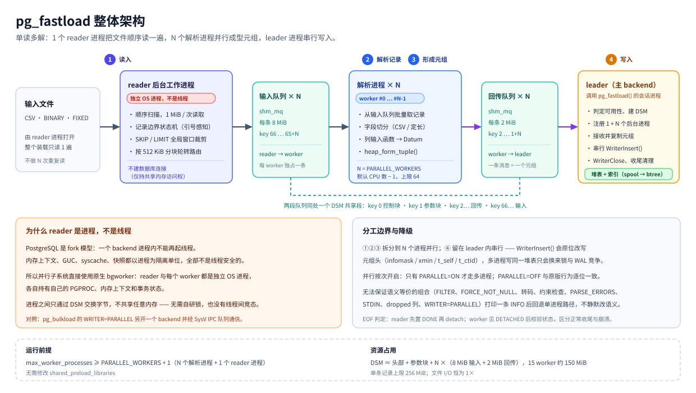

# pg_fastload 架构

> 适用版本 `1.0.0`。本文描述**现行实现**（单读多解并行架构），与实际代码一一对应。
> English version: [ARCHITECTURE.md](ARCHITECTURE.md) · 中文版：本文
> 参与实现：基于 pg_bulkload 3.1.23（版权 NTT, Inc.），并行子系统版权 (c) 2026 yuanyuansong。

---

## 1. 四阶段流水线

一次加载被划分为四个阶段，这是理解并行化改造的主线：

| # | 阶段 | 主要工作 | 代码 |
|---|---|---|---|
| ① | 读输入 | `SourceRead()` 从 INPUT 取字节流 | `lib/source.c` → `CSVParserRead()` |
| ② | 解析记录 | 记录边界扫描 + 字段切分、去引号/转义 | `lib/parser_csv.c` |
| ③ | 形成元组 | `CheckerConversion()` → `TupleFormerValue()`（列输入函数）→ `TupleFormerTuple()`（`heap_form_tuple`） | `lib/reader.c`、`lib/parser_csv.c` |
| ④ | 写入数据库 | `WriterInsert()`（DIRECT / BUFFERED；`WRITER=PARALLEL` 另起写入进程，见 §14） | `lib/writer_*.c` |

串行主循环（`lib/pg_fastload.c`）逐条驱动：

```c
while (wt->count < rd->limit)
{
    tuple = ReaderNext(rd);        /* ① + ② + ③ */
    if (tuple == NULL) break;
    WriterInsert(wt, tuple);       /* ④ */
    wt->count += 1;
    MemoryContextReset(wt->context);
}
```

`ReaderNext()` 内含 `PG_TRY/PG_CATCH`，负责逐行吸收解析错误并写 `PARSE_BADFILE`。

**并行化只动 ①②③**：`PARALLEL=ON` 且类型受支持时，主循环被替换为
`FastloadParallelRun()`，它消费 N 个 worker 回传的成型元组并逐条 `WriterInsert()`；
④ 及其全部语义（重复键处理、约束、事务、索引 spool）原封不动。

---

## 2. 整体架构图



英文版图：`img/architecture.svg`。

图中三个进程角色与一条共享内存通道，对应关系如下表。

---

## 3. 组件与职责

| 组件 | 进程形态 | 职责 | 关键代码 |
|---|---|---|---|
| **leader** | 发起 `pgfastload.pg_fastload()` 的 backend | `ParseOptions()`；`ReaderInit/WriterInit/CheckerInit/ParserInit`；创建 DSM（`dsm_create` + `dsm_pin_segment`）；注册 `N+1` 个动态 bgworker；**串行**消费回传队列并 `WriterInsert()`；汇总统计；`PG_CATCH` 中统一清理 | `lib/pg_fastload.c`、`lib/fastload_parallel.c` |
| **reader** | 动态 bgworker，**无数据库连接**（`BGWORKER_SHMEM_ACCESS` only），`handle[0]` | `open()` 输入文件，单遍顺序扫描；记录边界判定；`SKIP/LIMIT` 全局窗口裁剪；按 `FL_ROUTE_BYTES` 分块轮转分发；EOF 置位并 detach | `lib/fastload_worker.c` `pg_fastload_reader_main()` |
| **parser worker × N** | 动态 bgworker，完整 backend，`handle[1..N]` | `dsm_attach` → `shm_toc_attach`；用 DSM 中的列定义重建 `TupleDesc`（**不打开目标表**）；从输入队列取记录；字段切分 + 列输入函数 + `heap_form_tuple()`；经回传队列发送成型元组 | `lib/fastload_worker.c` `pg_fastload_worker_main()` |
| **共享协议** | DSM 匿名共享段 | 状态/错误/行数（key 0）、参数与列定义（key 1）、双向 `shm_mq`（key 2.. / key 66..） | `include/fastload_parallel.h` |
| **串行管道** | leader 进程内 | 原版 `reader`/`parser`/`checker`/`writer`/`source`：`PARALLEL=OFF` 或降级时使用，行为与 pg_bulkload 逐位一致 | `lib/reader.c`、`lib/parser_*.c`、`lib/writer_*.c` |
| **profile 埋点** | 编译期开关 | `USE_PROFILE=1` 时输出 GLOBAL / READER / WRITER / MERGE / PARALLEL / WORKER 六组计时 | `include/pg_profile.h`、`lib/pg_fastload.c` |
| **进度发布** | leader 内部 | 每个运行中的装载发布一条状态记录（`$PGDATA/pg_fastload/progress/<pid>.status`，原子 `.tmp` + `rename`），清理已死后端的记录；可选输出 `NOTICE`／`LOGFILE` 行（`PROGRESS_NOTICE=ON`） | `lib/progress.c` |
| **进度视图** | 任意会话 | `pgfastload.pg_fastload_progress`：枚举状态目录、在读取时计算 `percent`／速率／`eta_seconds` 的 SRF | `lib/progress.c` `pg_fastload_progress()`、`lib/pg_fastload.sql.in` |

### 3.1 模块划分

```
bin/pg_fastload.c        客户端：读控制文件 → 拼 options text[] → 执行 SQL
lib/pg_fastload.c        服务端入口 pgfastload.pg_fastload()
                          ParseOptions() / 主循环（串行或并行分派）/ 结果统计
lib/reader.c             Reader、Checker、TupleFormer、Filter
lib/parser_csv.c         单进程 CSV 解析器（降级路径与语义基准）
lib/parser_binary.c      BINARY / FIXED（定长）
lib/parser_tuple.c       TUPLE
lib/parser_function.c    FUNCTION
lib/source.c             文件 / STDIN / 异步读
lib/writer.c             Writer 抽象
lib/writer_direct.c      DIRECT（绕过 shared buffers + LSF）
lib/writer_buffered.c    BUFFERED
lib/writer_binary.c      定长文件写者（`WRITER=BINARY` 与导出共用）
lib/writer_csv.c         定长之外的另一半：CSV 文件写者（仅导出使用）
lib/writer_parallel.c    PARALLEL（上游「主读子写」多进程）
lib/export.c             导出入口 pgfastload.pg_fastload_export()：选项解析、请求解析、
                         串行 SPI 游标扫描 → Writer、并行分发
lib/pg_btree.c           索引 spool 批量构建
lib/progress.c           装载/导出进度：状态记录 + pg_fastload_progress SRF
lib/pgut/*               上游工具库（PARALLEL writer 依赖 pgut-ipc.c）

并行子系统（(c) 2026 yuanyuansong）
lib/fastload_parallel.c  编排：DSM/队列创建、bgworker 注册、
                         FastloadParallelSupported() 降级判定、
                         FastloadParallelRun()（leader 消费循环）、
                         FastloadDefaultWorkers()（默认 worker 数的唯一定义）
lib/fastload_worker.c    reader 单遍扫描/路由 + worker 消费/解析/回传
lib/export_parallel.c    导出编排：DSM + 每 worker 一条 shm_mq、writer bgworker
                         （只做 write + fsync）、查询 bgworker（块区间扫描 + 格式化）、
                         FlExportParallelSupported() / FlExportParallelTry()
include/fastload_parallel.h  DSM 布局、参数/头结构、key 常量、队列容量
include/export_parallel.h    导出 DSM 布局：FlExportShared / FlExportParams / FlExportChunk
include/pg_profile.h     USE_PROFILE=1 阶段计时埋点
```

---

## 4. 单进程数据流（`PARALLEL=OFF`，默认）

```
控制文件/SQL 参数
   → ParseOptions() → WriterCreate(WRITER) + ReaderCreate(TYPE)
   → ReaderInit / WriterInit / CheckerInit / ParserInit
   → [ ReaderNext ①②③ → WriterInsert ④ ] × N 行
   → WriterClose / ReaderClose → 统计与日志
```

与原版 `pg_bulkload` 完全一致；本项目对该路径只做过两处与语义无关的改动：
worker 默认值改为调用统一的 `FastloadDefaultWorkers()`，以及 `SpoolerInsert()` 的无索引早退。

### 4.1 反方向：串行导出数据流（`PARALLEL=OFF`）

导出不经过 `Reader`/`Parser`（那是"字节 → 元组"），而是从**已经成型**的元组出发：

```
TABLE=/QUERY= 参数
   → ParseExportOptions() → WriterCreate(TYPE)：CSV → CsvWriter，BINARY/FIXED → BinaryWriter
   → SPI_connect → SPI_cursor_open_with_args(query, read_only)
   → [ SPI_cursor_fetch(1000) →（BINARY/FIXED 时 checker 按 OUT_COL 转换）→ WriterInsert ] × N
   → WriterClose（fsync）→ ProgressFinish → SPI_finish
```

三点设计约束：

| 约束 | 原因 |
|---|---|
| 用 SPI 游标而不是 `table_beginscan()` | `QUERY=` 与 `TABLE=` 才能共用一条路径；游标自带调用方快照、权限与行可见性，与普通 `SELECT` 完全等价 |
| 元组必须先过 `wt->tchecker->checker` 才能进 `BinaryWriter` | 装载时元组的类型来自目标表 `TupleDesc`；游标元组可能没有类型 OID，因此 `BinaryWriterSetSourceDesc()` 显式把结果行的 `TupleDesc` 交给 checker，同时完成宽度/范围校验 |
| CSV 用独立 writer，定长复用 `BinaryWriter` | 装载侧本来就没有"写 CSV"的实现（只有 `parser_csv.c`）；而定长布局的描述符 `COL` 早已存在，导出的 `OUT_COL` 就是它的镜像 |

`QUERY=` 永远走这条路径；`TABLE=` 只在无法拆分时（§4.2 的回退清单）走这条路径。

### 4.2 并行镜像（`PARALLEL=ON`，`TABLE=` 的默认行为）

装载管线是*单 reader → N parser → 1 次串行插入*；导出的管线是它严格的反向：
**N 个查询进程 → 1 个写文件进程**，写进程是唯一的串行段，且它只做 `write(2)`。

```
leader（只做编排：DSM、启动 worker、进度、样例 .ctl）
   │
   ├─ 先起 writer bgworker，再起 N 个查询 bgworker
   │
查询进程 0 ──shm_mq 0──┐
查询进程 1 ──shm_mq 1──┤
    ...                ├──→ writer 进程 ──→ OUTPUT 文件
查询进程 N-1 ──shm_mq N┘        （fsync 后回报行数/字节数）
```

所有花 CPU 的事都在 worker 里：堆扫描、元组解构、`OutputFunctionCall`，以及 CSV 的加引号状态机。
这四项就是串行导出的全部成本（见 [BENCHMARK §8](BENCHMARK.zh-CN.md)），所以把它们搬到进程边界
另一侧是净收益 —— 即便每个格式化后的字节都要过一次共享内存。

| 关注点 | 并行导出 | 并行装载（§5） |
|---|---|---|
| 扇出/扇入 | N 个 worker → 1 个 writer | 1 个 reader → N 个 worker |
| 串行段 | writer 进程（`write` + `fsync`） | leader（`WriterInsert`） |
| 跨边界数据 | 已格式化的字节 | 原始记录（字节）或定长行 |
| 分片键 | ctid **块区间**（`heap_setscanlimits`） | 输入文件中的字节偏移 |
| 行序 | **不保证**（按到达顺序） | 保证 |
| `QUERY=` | 回退串行 | 不适用 |
| 进度来源 | writer 的字节/行计数 | 各 worker 的计数 |

#### 切分扫描

每个 worker 从 `bgw_extra` 拿到 `FlExportWorkerId {worker_id, start, nblocks}`，然后：

```c
scan = FL_TABLE_BEGINSCAN(rel, snap);
heap_setscanlimits(scan, wid.start, wid.nblocks);
```

`heap_setscanlimits()` 的块是物理块，不是逻辑块：一段区间会产出 ctid 落在其中的**所有可见元组**，
顺序取决于可见性映射与上一个使用的缓冲区。因此分片互不相交且完备，运行期不需要任何协调 ——
没有共享工作队列、没有任务窃取、没有锁。块按整除均分（`nblocks / nworkers`，余数给前面的 worker）。

除此之外什么都不共享：每个 worker 自己打开关系、自己恢复 leader 序列化的快照
（`RestoreSnapshot`）、自己按选项 blob 重建 writer。

#### 为什么用块区间而不是 `ctid BETWEEN`

`ctid` 谓词会被下推成过滤条件，于是每个 worker 仍要扫过每一页、再把大部分丢掉 —— N 倍读放大
而不是 1 倍。`heap_setscanlimits()` 把区间塞进扫描描述符本身：每个 worker 从自己的块开始、
到自己的块结束。

#### 行序不保证

查询进程把它那段的产出直接追加，写进程按**到达顺序**落盘。因此文件是一份合法、完整的转储，
行序取决于调度。这是写入文档的契约（[USER_MANUAL §18.1](USER_MANUAL.zh-CN.md)），也是数据通路
可以无锁的原因，更是验收脚本按**行集**而不是逐字节比较输出的原因
（`util/fl_export_parallel_test.sh`）。任何对顺序敏感的需求都属于 `QUERY=`（串行路径），
或者回灌后的 `ORDER BY`。

`LIMIT=` 依然精确：各 worker 用 `pg_atomic_fetch_add_u64(&rows_reserved, CHUNK_ROWS)` 抢占预算、
可以随意超订，最后一个把本块裁到剩余额度。于是 `LIMIT=n` 恰好返回 `n` 行 —— 只是顺序不保证，
所以是"某个 n 行子集"。

---

## 5. 并行数据流（`PARALLEL=ON`）

### 5.1 leader

```
ParseOptions / ReaderInit / WriterInit / CheckerInit / ParserInit（照常，串行路径的初始化全部保留）
 ├─ dsm_create + dsm_pin_segment（容量按实际 worker 数伸缩）
 │    ├─ key 0                FastloadShared   spinlock、reader/worker 状态、错误文本、行数、profile
 │    ├─ key 1                FastloadParams   CSV 参数 / 列定义 / 定长描述符 / SKIP / LIMIT / worker 数
 │    ├─ key 2 .. 2+N-1       回传 shm_mq × N  worker → leader，2 MiB/个
 │    └─ key 66 .. 65+N       输入 shm_mq × N  reader → worker，8 MiB/个
 ├─ 注册 N+1 个动态 bgworker：handle[0]=reader，handle[1..N]=parser worker
 └─ 消费循环（④ 串行）
      for each 回传队列（round-robin）:
          shm_mq_receive → 可写副本（palloc 在 wt->context）→ 组装 HeapTupleData
          → WriterInsert(wt, &tup) → wt->count++ → MemoryContextReset(wt->context)
      全部 worker DONE 或达到 LIMIT → 结束
```

### 5.2 reader

```
open(INPUT)
 ├─ 记录边界状态机（CSV）/ STRIDE 切分（定长），每次读 FL_READ_CHUNK = 1 MiB
 ├─ 全局记录号 rec_no：跳过 [0, skip)，超过 limit 即停止（先减法再比较，避免 int64 溢出）
 ├─ 路由：[当前 owner 累计字节 ≥ FL_ROUTE_BYTES(512 KiB)] → owner = (owner+1) % N
 │         记录追加进 FL_STAGE_CAP(512 KiB) stage 缓冲，攒满后一次 shm_mq_send 给 owner
 └─ 结束：hdr->reader_state = FL_WORKER_DONE → 对每个输入队列 shm_mq_detach
```

### 5.3 parser worker #i

```
dsm_attach → shm_toc_attach → 取 FastloadShared / FastloadParams
BackgroundWorkerInitializeConnection(dbname, username)   /* 需要 syscache 与输入函数 */
StartTransactionCommand()
由 cols[] 重建 TupleDesc（不打开目标表，避免与 leader 的 AccessExclusiveLock 冲突）
TupleFormerInit(...)
loop:
    shm_mq_receive(mq[i])            /* 整帧在同一消息内 → 零拷贝快路径 */
    跨消息重组不完整记录到 pend 缓冲（FL_PEND_INIT = 64 KiB）
    字段切分 → TupleFormerValue / TupleFormerTuple
    shm_mq_send(mq_return[i], tuple, len)
EOF 判定：SHM_MQ_DETACHED → 校验 reader_state == DONE ?
    → 是：正常收尾，发布统计，置 FL_WORKER_DONE，detach，proc_exit(0)
    → 否：reader 崩溃，置 FL_WORKER_FAILED 并写入错误文本
```

### 5.4 为什么文件 I/O 只发生一次

CSV 不是可随机访问格式：把文件按字节区间分给 N 个进程时，每个起跑点都可能落在引号字段内部，
`in_quote` 初值无法确定。单读多解架构因此把「扫文件」收敛为**单点顺序扫描**：

- 总读量恒为 `1 ×` 文件大小（首版的「N 个 worker 各自全量扫描」在文件超出 page cache 时
  比串行慢 6.49×）；
- 记录边界状态机只跑一遍，不再 N 份重复；
- 代价是 reader 成为单点：它必须能把 N 个 worker 喂饱，这由 8 MiB 队列 + 分块轮转保证（§6）。

---

## 6. 记录边界、路由与帧协议

### 6.1 记录边界状态机（reader 内）

reader 只判断"一条记录到哪结束"，不切字段。状态机带 `in_quote` 上下文：

| 当前状态 | 字节 | 处理 | 是否记录结束 |
|---|---|---|---|
| 引号内 | `escape` + (`quote` 或 `escape`) | 两字节原样保留 | 否 |
| 引号内 | `quote` | 原样保留，退出引号态 | 否 |
| 引号内 | `\r` / `\n` / 其他 | **原样保留**（属于字段内容） | 否 |
| 引号外 | `quote` | 原样保留，进入引号态 | 否 |
| 引号外 | `\r` | 结束记录；下一字节若是 `\n` 一并吞掉 | **是** |
| 引号外 | `\n` | 结束记录 | **是** |
| 引号外 | 其他 | 原样保留 | 否 |

要点：

- **CRLF 双重语义**：引号内的 `\r\n` 是字段值必须逐字节保留，只有引号外的才是终止符；
- **单字节 lookahead**：CRLF 与 `""` 转义都要看下一字节；1 MiB 读块末字节 carry 到下一块；
- **末条无终止符**：`rec_used > 0` 时补发一条；若此时 `in_quote` 仍为真，报
  `unterminated CSV quoted field`；
- **跨块长记录**：记录缓冲从 64 KiB 起按需翻倍，上限 `FL_REC_MAX = 256 MiB`。

### 6.1a 字段切分：两档实现，同一语义

上面的记录边界只回答「一条记录到哪结束」。把字节变成字段是第二步，这一步有两套输出完全一致的实现：

| 档位 | 触发条件 | 做法 | 每 1 GiB 成本 |
|---|---|---|---|
| 快档（串行 `CSVPlainRecord()`，worker `fl_parse_fields_plain()`） | 记录中**既无引号也无 `\r`** | 一次 `memchr('\n')`、一次引号/回车预扫描、把记录整条复制进字段缓冲，随后每个分隔符字节就地改成上一字段的 NUL 结尾 | 0.90 s |
| 参考档（`CSVParserRead()` 循环 / `fl_parse_fields()` 循环） | 带引号字段、转义引号、引号内 CRLF、lone CR、未闭合引号、`FILTER`、无目标列 | 逐字节状态机，边去引号/反转义边拼字段缓冲 | 1.92 s |

快档从不改动记录缓冲，因此 `ParserDumpRecord()`、`strlen(self->cur)` 判断与缓冲补数据看到的
仍是原始字节；`field_num`、`parsing_field`、`base.count` 完全复刻，包括「多余列覆盖最后一个
目标列」与「空行是一个 NULL 字段」。是否可走快档在**改动任何字节之前**判定，这正是回退安全的
前提（90 项断言集用 quoted / lone-CR / cross-chunk 用例钉住这一点）。

### 6.2 路由：按字节量分块轮转

每累计约 `FL_ROUTE_BYTES = 512 KiB` 连续记录切换一次 owner，窗口内记录整块写入该 owner 的输入队列。

- 逐条 `rec_no % N` 交错路由会造成**队头阻塞**（一条队列满就卡住全部路由，实测 reader 阻塞 9.2 s），
  分块轮转消除该问题；
- 不保证记录按原始顺序到达，也不保证各 worker 行数均分——正确性契约是**内容集合一致**（§8）；
- `SKIP/LIMIT` 在路由前按全局记录号裁剪，窗口外记录直接跳过。

### 6.3 帧协议

输入队列上每条消息是一个帧：

```
+--------+--------+-------------------+
| len:u32| rsv:u32|  record bytes ... |     FL_HDR_LEN = 8
+--------+--------+-------------------+
```

- `len` 为该记录的字节数；worker 校验 `len ≤ FL_REC_MAX`；
- 正常情况下 `shm_mq_receive` 一次返回完整帧（同消息内），worker 直接零拷贝解析；
- 记录大于队列剩余空间时消息会被拆开，worker 用 `pend` 缓冲重组。

### 6.4 容量取值的由来

| 常量 | 值 | 依据 |
|---|---|---|
| `FASTLOAD_INPUT_MQ_SIZE` | 8 MiB | 1 MiB 只缓冲约 6 ms 的 worker 工作量，reader 被单个队列背压阻塞时其余队列全部挨饿（worker 空闲约 45%）；8 MiB ≈ 16 个路由块，可跨越阻塞窗口 |
| `FASTLOAD_QUEUE_SIZE`（回传） | 2 MiB | leader 串行写入的瞬时抖动缓冲 |
| `FL_READ_CHUNK` | 1 MiB | 把 1 GiB 的 `read()` 次数从 16386 降到 1026 |
| `FL_STAGE_CAP` | 512 KiB | 把 `shm_mq_send()` 次数从 17193 降到 2148 |
| `FL_ROUTE_BYTES` | 512 KiB | 路由粒度与 stage 缓冲对齐，一次发送即一个轮转窗口 |

---

## 7. 进程间通信：PostgreSQL 内核原语

并行路径不使用 `pgut/pgut-ipc.c` 的 `Queue`（上游 `WRITER=PARALLEL` 仍依赖它，保留在构建中），
全部使用 PG 原生原语：

| 原语 | 用途 |
|---|---|
| `dsm_create` / `dsm_attach` / `dsm_pin_segment` / `dsm_unpin_segment` | 创建/附加/固定共享段 |
| `shm_toc_create` / `shm_toc_attach` / `shm_toc_allocate` / `shm_toc_lookup` | 段内对象定位 |
| `shm_mq_create` / `shm_mq_set_sender` / `shm_mq_set_receiver` / `shm_mq_attach` / `shm_mq_send` / `shm_mq_receive` / `shm_mq_detach` | 双向消息队列 |
| `RegisterDynamicBackgroundWorker` / `WaitForBackgroundWorkerStartup` | worker 生命周期 |
| `spin.h`（`FastloadShared.mutex`） | 只保护状态/错误/行数等小字段，不做数据面同步 |

### 7.1 DSM 布局

| key | 对象 | 大小 | 内容 |
|---|---|---|---|
| 0 | `FastloadShared` | ~50 KiB | `slock_t mutex`、`nworkers`、`reader_state`、`reader_failed`、`reader_error[256]`、`reader_scan`、`worker_state[]`、`worker_rows[]`、`worker_error[][]`、profile 三元组 |
| 1 | `FastloadParams` | 变长 | `nworkers`、`natts`、`pmode`（CSV / FIXED）、`nbinfields`、`rec_stride`、`skip`、`limit`、`delim`/`quote`/`escape`、`nullstr[64]`+`null_len`、`encoding`、`collation`、`infile`、`dbname`、`username`、`cols[]`（+ 定长描述符 blob） |
| 2 .. 2+N-1 | 回传 `shm_mq` × N | 2 MiB/个 | worker → leader，每条消息一个成型元组 |
| 66 .. 65+N | 输入 `shm_mq` × N | 8 MiB/个 | reader → worker，每条消息一个帧（通常一条记录） |

`FASTLOAD_KEY_INPUT_BASE = 2 + FASTLOAD_MAX_WORKERS(64) = 66`，用固定高基址保证两组 key 永不冲突
（即使 worker 数变化）。`FASTLOAD_MAX_WORKERS = 64` 同时界定 `FastloadShared` 的数组大小。

导出方向使用**自己**的 DSM 段（`FL_EXPORT_SHM_MAGIC`），因此导出与装载永远不会误挂到对方的内存上：

| key | 对象 | 大小 | 内容 |
|---|---|---|---|
| 0 | `FlExportShared` | ~17 KiB | `slock_t mutex`、`nworkers`、`writer_state`、`writer_error[256]`、`worker_state[]`、`worker_rows[]`、`worker_error[][]`、`rows_written`、`bytes_written`、`abort_requested`、`pg_atomic_uint64 rows_reserved` |
| 1 | `FlExportParams` | 变长 | `nworkers`、`type`、`natts`、`limit`、`header`、`relid`、`nblocks`，以及 `data[]` 里三段 blob：表头文本、`SerializeSnapshot` 输出、writer 选项表（`KEY\0value\0`） |
| 2 .. 2+N-1 | `shm_mq` × N | 2 MiB/个 | worker → writer，一条 `FlExportChunk` 头 + `nbytes` 字节已格式化输出 |

`FlExportChunk { int32 nrows; int32 nbytes; }` 在每条消息最前面。写进程不解析行 —— 它只追加
`nbytes` 字节、累加 `nrows` —— 所以一块数据就是纯粹的一段字节，写进程里没有任何格式相关代码。

### 7.2 EOF 与失败判定

正常收尾与崩溃必须可区分，否则 worker 会把"leader/reader 死了"当成"文件读完了"：

```
reader 正常结束:  hdr->reader_state = FL_WORKER_DONE   →  逐队列 shm_mq_detach
reader 异常结束:  hdr->reader_state = FL_WORKER_FAILED + reader_error[]  →  detach
worker 收到 SHM_MQ_DETACHED:
    reader_state == DONE   → 正常 EOF：发布统计 → FL_WORKER_DONE → detach → proc_exit(0)
    reader_state != DONE   → 置 FL_WORKER_FAILED + 错误文本 → 退出
leader 收到 SHM_MQ_DETACHED（worker 侧）:
    容忍 DETACHED + FL_WORKER_DONE（worker 可能抢在 leader 之前跑完）
    仅对"未到达 DONE"的 worker 报错（复制错误文本到本地缓冲后再释放 spinlock）
```

PG 官方语义保证：sender detach 后 receiver 仍可读走队列中剩余消息，因此"小文件 worker 先跑完"
不是错误路径。

导出方向的失败判定同理，只是方向相反：

```
writer 正常：  writer_state = FL_WORKER_DONE，发布 rows_written / bytes_written
writer 异常：  writer_state = FL_WORKER_FAILED + writer_error[]（ENOSPC、EACCES 等）→ close(fd) → 退出
worker 异常：  worker_state[i] = FL_WORKER_FAILED + worker_error[i] → detach → 退出
worker 收到 SHM_MQ_DETACHED: fl_export_send_chunk() 返回 false → 提前收工，自己不报错
leader 轮询：
    writer_state == FAILED → 置 abort_requested、读 writer_error[]、ereport(ERROR)
    writer_state == DONE   → 要求所有 worker 都 DONE，然后返回行数/字节数
```

`abort_requested` 是"写进程失败如何停下 worker"的答案：worker 每块重读一次，所以输出文件坏掉时
每个 worker 最多浪费一块的工作量，而不是跑完整张表。反过来，单个 worker 失败不需要停掉同伴 ——
写进程只是少了些行，leader 报 worker 的错误而不是行数。

---

## 8. 正确性契约

heap 表不承诺物理行序，`WriterInsert` 也不依赖输入顺序。并行加载的正确性判据是**内容集合一致**：

```sql
SELECT count(*) || '|' || sum(hash_record_extended(t, 0)) FROM public.t AS t;
```

（顺序无关摘要，不使用 `md5(string_agg(...))` 这类依赖行序的校验。）

验证套件以此断言：

| 套件 | 用例数 | 覆盖 |
|---|---|---|
| CSV | 90/90 | 边界数据集（CRLF / 孤立 CR / 引号内换行 / 转义 / 跨 64 KiB 块 / 空文件 / 万行）、自定义解析参数、SKIP+LIMIT、并行度 1/2/3/4/auto、降级回归、启动竞态 |
| 定长 | 44/44 | 纯 CHAR、BINARY/FIXED 别名、二进制数值、NULLIF、STRIDE 填充、尾残字节、SKIP+LIMIT、PRESERVE_BLANKS、空文件、w1 回退、FILTER 降级、万行分片 |

详见 [VERIFICATION.md](VERIFICATION.md)。

---

## 9. 为什么 ④ 保持串行

1. `WriterInsert()` 会**原地修改** `tuple->t_data`：infomask、xmin/cmin/xmax、OID、`t_self`、`t_ctid`。
   多进程同时写同一张堆表只会引入锁与 WAL 竞争，收益不确定。
2. leader 收到的是共享内存中的**只读**消息，必须在 `wt->context` 中 `palloc` 出可写副本再交给
   `WriterInsert()`——这是必做步骤，不是优化。
3. 上游三种 WRITER（DIRECT / BUFFERED / PARALLEL）因此全部无需改动。
4. **写入路径复查（2026-11-09）**：DIRECT writer 的 WAL 本就是每次装载一条首页记录
   （`writer_direct.c` 首页守卫），数据写已按 1024 页（8 MiB）块缓冲批量 `write()`，无批量化空间；
   WRITE 段 ~1.3 s/1 GiB 是纯逐元组 CPU（`PageAddItem` + 元组头戳记 + `SpoolerInsert`），
   构成 leader 串行下限。并行填页的理论上限仅 ~1.10×（auto 档管线关键路径是 reader 的 READ 段），
   按"收益有限即放弃"原则维持 ④ 串行。

> 顺带结论：`WRITER=PARALLEL`（上游的"第二个 backend 写"）不并行化插入本身，且用独立事务破坏
> 调用方 `BEGIN/COMMIT` 原子性，因此 `PARALLEL=ON` 与之互斥（见 §10）。

---

## 10. 并行度、串行回退与降级

```
PARALLEL_WORKERS 显式指定 → 取该值（1..64）
未指定                   → FastloadDefaultWorkers() = 在线 CPU 核数 − 1（下限 1，上限 64）
有效 worker 数 ≤ 1        → FastloadParallelSupported() 返回 false → 串行回退
```

worker 数取 `CPU − 1` 的理由：④ 写入的 leader 独占一个核，reader 另占一个 bgworker 槽位。
16 核典型配置 = 15 解析 worker + 1 reader + 1 写入 leader，因此
**`max_worker_processes ≥ N + 1`**。

`FastloadParallelSupported()` 的判定顺序（命中即打印一条 INFO 并返回 false）见
[USER_MANUAL §10.4](USER_MANUAL.md#104-自动降级不会失败只会变慢) 的 13 条清单。

一条重要的**反向约定**：`rd->checker.tchecker != NULL` **不是**降级条件。所有 writer 都无条件
`CreateTupleChecker()`，该指针恒非 NULL；对 `TYPE=CSV`，`CoercionCheckerTuple()` 判定
`NO_COERCION` 后原样返回 tuple，与 worker 的 `TupleFormerTuple()` 输出逐位等价。
早期版本把它当条件，导致并行被无声关闭——注释与文档中已标注"不可加回"。

---

## 11. 定长（`BINARY` / `FIXED`）并行

`TYPE=BINARY` 与 `TYPE=FIXED` 在 `reader.c` 中映射到同一个定长解析器（`COL` 描述 + `STRIDE`），
并行化共用 CSV 的全部基础设施，只替换两处：

**① reader 侧记录边界**（`fl_reader_scan_fixed`）：无引号、无分隔符，按 `STRIDE` 定长切分。
读入 1 MiB chunk + 结转不足一条记录的尾部字节；帧协议、`SKIP/LIMIT` 窗口、分块轮转与 CSV 完全一致。
EOF 尾残字节 WARNING 忽略（对齐串行行为）。

**② worker 侧字段解析**（`fl_emit_record_fixed`）：leader 用 `BinarySerializeFields()` 把解析好的
`COL` 描述符（kind 索引 + offset + len + nullif）序列化进 DSM 参数块，worker 用
`BinaryDeserializeFields()` 重建 `Field[]`——read/write 函数指针**不跨进程传递**，由 kind 从静态
`TYPES[]` 表重新解析，`CHAR` 类字段的 work buffer 由 worker 重新分配。解析流程镜像串行
`ExtractValuesFromFixed()`：队列内存只读 → 先拷贝到 scratch → 每字段尾临时写 NUL（供 `Read_char`
的 strlen/截尾与 `NULLIF` 定界）→ 调用 `field->read()` → 还原。`STRIDE` 校验（`len != rec_stride`）
保证 reader 侧任何切分缺陷都会显式失败，而不是静默错位。

数值字段按目标列 typId 直接 C-cast（`Read_int32` 等），零字符串解析开销——这是定长串行装载
（1 GiB 1.62 s）远快于 CSV 串行（8.0 s）的主因，也是并行收益相应收窄（最高 1.82×）的原因。

---

## 12. 为什么 reader 与 worker 都是独立进程，而不是线程

**结论：全部是进程，没有线程。** reader 与每个解析 worker 都由
`RegisterDynamicBackgroundWorker()` 创建，是拥有独立 PID 的 PostgreSQL 后台工作进程
（bgworker），与调用 `pg_fastload()` 的 backend 平级。线程在这个项目里一次都没用到。

原因是 PostgreSQL 的后端模型本身不提供线程：

| 约束 | 说明 |
|---|---|
| 进程全局量 | `CurrentMemoryContext`、`PG_exception_stack`、`MyProc` 都是进程级全局变量，多线程会互相踩踏 |
| 错误处理 | `ereport(ERROR)` 通过 `siglongjmp` 跳到当前 backend 的错误栈，线程之间无法隔离 |
| 输入函数 | `TupleFormerValue()` 调用 `int4in` / `numeric_in` / `bpcharin` 等 PG 输入函数，只能在完整 backend 里安全执行 |
| 事务与缓存 | 每个 worker 需要自己的 syscache、relcache 与事务状态，这些结构都不是线程安全的 |

`RegisterDynamicBackgroundWorker` 提供的正是这种进程：有自己的 MemoryContext、syscache、事务，
因此可以安全复用原版的 ③ 逻辑，也天然获得错误隔离与独立的内存上限。
代价是进程之间不能共享任意指针 —— 所以传输全部走 DSM 上的 `shm_mq` 字节队列。

---

## 13. 内存生命周期

| 位置 | 上下文 | 说明 |
|---|---|---|
| worker 长期对象 | `workctx = AllocSetContextCreate(TopMemoryContext, ...)` | TupleDesc、参数副本、输入缓冲 |
| worker 每条记录 | `recctx` | `shm_mq_send()` 已把字节复制进队列，随后 `MemoryContextReset(recctx)`，130M 条不累积 |
| leader 编排对象 | 独立 `runctx` | DSM、`shm_mq_handle`、bgworker handles、`done[]`。**不能放 `wt->context`**（后者每行被 reset） |
| leader 每条消息 | `wt->context` | `MemoryContextAlloc` 出可写副本 → `WriterInsert()` → `MemoryContextReset` |
| 异常路径 | `PG_CATCH` | 统一执行 `fastload_cleanup()`：终止 worker、`shm_mq_detach`、`dsm_unpin_segment` + `dsm_detach`，再 `PG_RE_THROW()` |

新增并行代码**不使用** `malloc/calloc/realloc/free`；`pg_fastload.so` 的动态符号表中没有
malloc 族未定义符号（静态核查见 [VERIFICATION.md](VERIFICATION.md)）。

---

## 14. 与其他并行方案的关系

| 方案 | 并行的是 | 传输 | 事务 | 在本项目中的状态 |
|---|---|---|---|---|
| 串行管道 | 无 | — | 调用方事务 | 默认路径，`PARALLEL=OFF` |
| `PARALLEL=ON`（本项目） | ①②③ | 内核 `shm_mq` | 调用方事务 | 现行并行路径 |
| `WRITER=PARALLEL`（上游） | ④ 拆到另一个 backend | SysV IPC + libpq | **独立事务** | 保留原语义，不与 `PARALLEL=ON` 叠加 |
| PG 原生 parallel query | 查询执行 | 内核 `shm_mq` | 调用方事务 | 不适用于批量装载（不绕过 buffer manager） |

---

*相关文档：[用户手册](USER_MANUAL.md) · [修改点](CHANGES.md) · [性能基准](BENCHMARK.md) ·
[验证报告](VERIFICATION.md) · [优化记录](OPTIMIZATION.md)*
